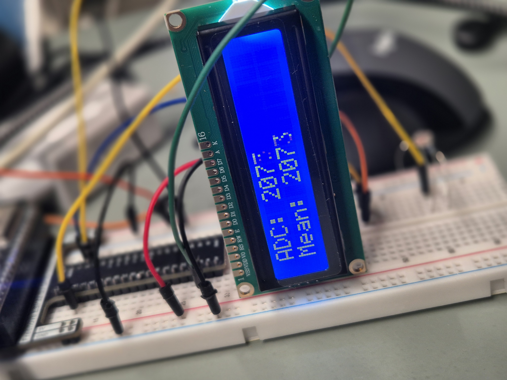
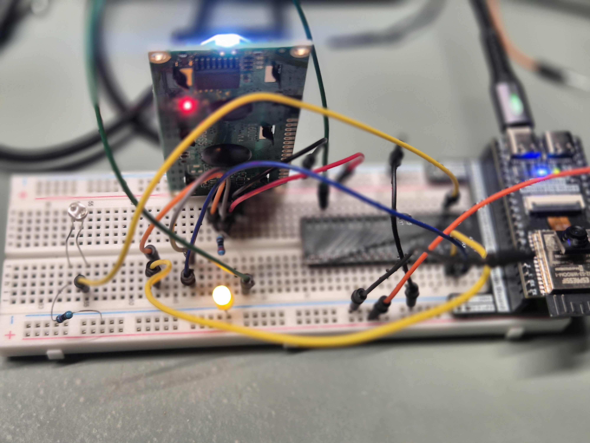
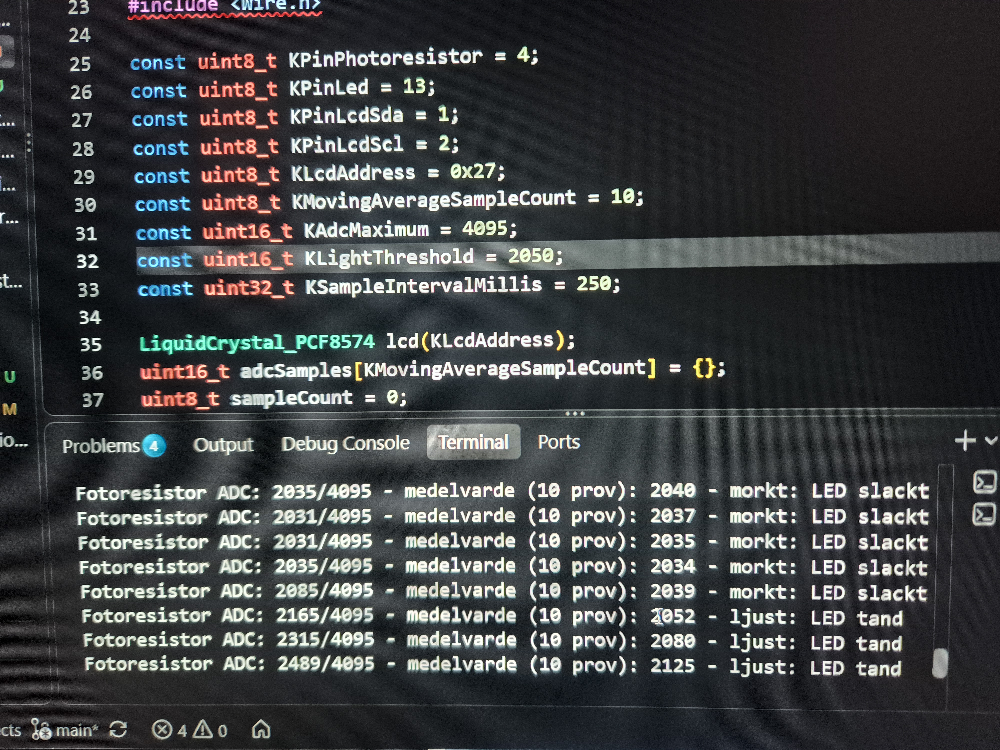

# Lab 6B: Fotoresistor med I2C-display

Läs av ljuset med en GL5516-fotoresistor och visa aktuellt ADC-värde samt ett
flytande medelvärde på en 16×2 LCD med I2C-adapter. Värdena skrivs också ut
via seriell monitor. En LED visar om medelvärdet ligger över den inställbara
ljuströskeln.

## Kravspecifikation

### Övergripande

Kretsen ska mäta ljusnivån med ESP32-S3 och ge återkoppling både på LCD:n och
i den seriella monitorn.

### Funktionella krav

- Läsa fotoresistorns analoga signal på GPIO 4. GPIO 1 används redan av
  LCD:ns SDA-ledning.
- Visa det aktuella ADC-värdet och ett rullande medelvärde på LCD:n.
- Skriva värdena till seriell monitor med 115200 baud.
- Tända LED:en när medelvärdet är minst `KLightThreshold`; tröskeln ska kunna
  justeras efter uppmätta värden.
- Behålla LCD:ns befintliga koppling från Lab 7: adress `0x27`, SDA GPIO 1 och
  SCL GPIO 2.

### Målbild för framtiden

- Kalibrera ljuströskeln efter mätningar i olika ljusmiljöer.
- Visa ljusnivån som procent eller med en enkel graf.
- Undersöka hur storleken på medelvärdesfönstret påverkar stabilitet och
  svarstid.

## Komponenter

- ESP32-S3 Freenove-kort
- 16×2 LCD med PCF8574T I2C-adapter
- GL5516-fotoresistor
- 10 kΩ motstånd
- LED
- 220 Ω motstånd
- Kopplingsdäck och ledningar

## Koppling

| Komponent | Anslutning |
|---|---|
| Fotoresistor | 3.3V → fotoresistor → GPIO 4/mätpunkt |
| 10 kΩ | GPIO 4/mätpunkt → 10 kΩ → GND |
| LCD VCC/GND | 3.3V / GND |
| LCD SDA | GPIO 1 (behåll befintlig anslutning) |
| LCD SCK/SCL | GPIO 2 (behåll befintlig anslutning) |
| LED-anod (långt ben) | GPIO 13 via 220 Ω |
| LED-katod (kort ben) | GND |

Anslut alla jordpunkter till ESP32-kortets GND. Börja med att driva LCD-modulen
från 3.3V så att I2C-linjerna inte dras upp till 5V. En del LCD-moduler kan
behöva 5V för tydlig visning; använd inte 5V utan att först säkerställa att
SDA och SCL inte får 5V-signaler mot ESP32-S3:ans GPIO.

## Testa och verifiera

1. Bygg och ladda upp `lab6b_fotoresistor_i2c.cpp`.
2. Öppna seriell monitor med 115200 baud.
3. Kontrollera att LCD:n visar aktuellt ADC-värde och medelvärde.
4. Lys på fotoresistorn och täck den. Värdena ska ändras med ljuset.
5. Kontrollera att LED:en reagerar när medelvärdet passerar
   `KLightThreshold`. Justera tröskeln efter mätningarna.
6. Kontrollera att Git-repot innehåller programfilen och denna beskrivning.

Medelvärdet beräknas över de senaste 10 mätningarna. En ny mätning tas var
250:e millisekund.

LCD-kopplingen är oförändrad från Lab 7, eftersom jag glömde göra Lab 6b före Lab 7. Fotoresistorn ansluts till GPIO 4 för
att undvika att dela GPIO 1 med LCD:ns SDA-ledning.

## Implementering och Realisering

## AI-stöd

En AI-assistent användes för att ta fram ett första utkast till kod och
dokumentation. Granska och anpassa innehållet efter den faktiska kopplingen,
mätresultaten och kursens regler för dokumentation av AI-användning.
