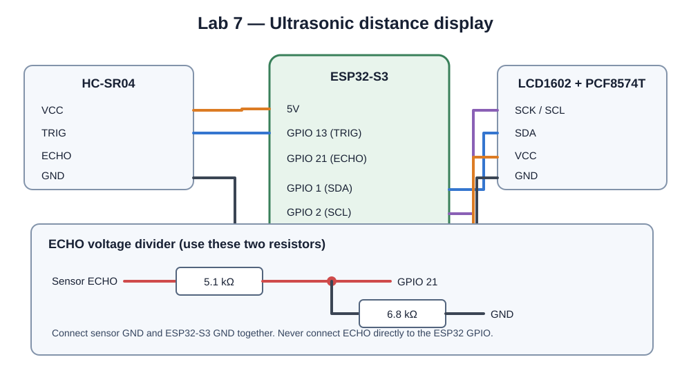
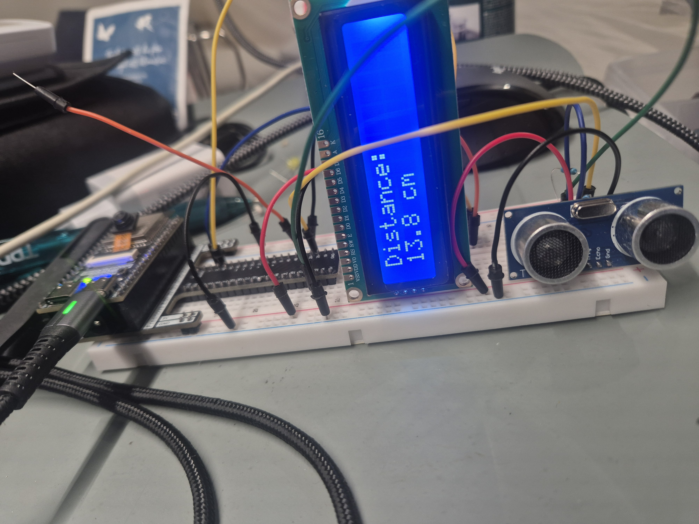
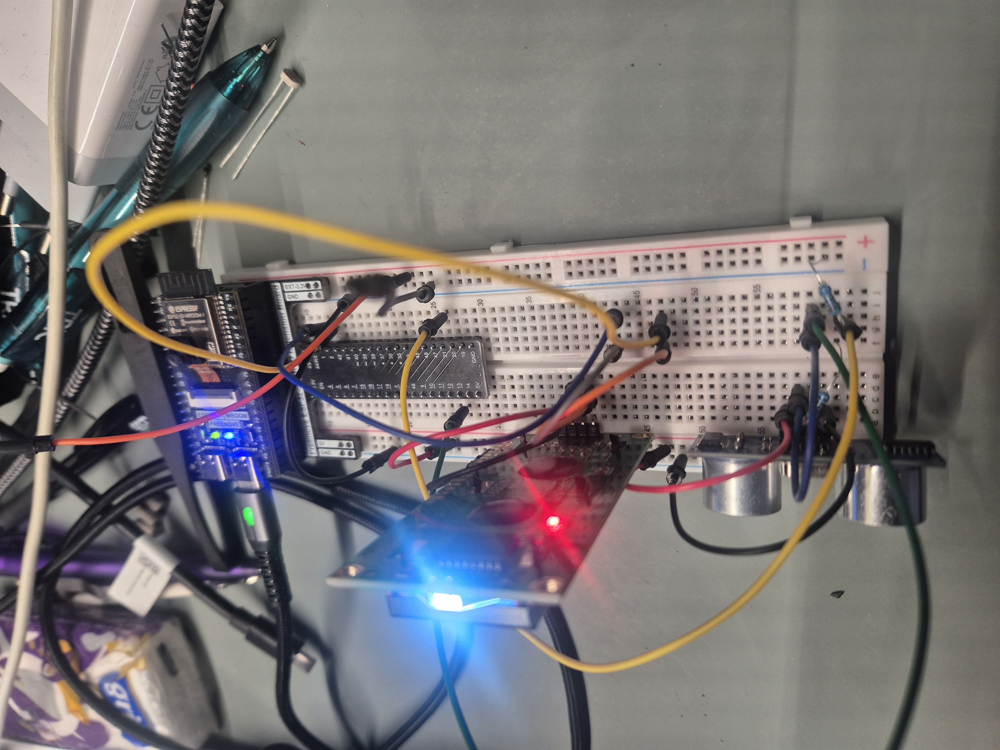

# Lab 7: Ultrasonic Distance Measurement

Use an ultrasonic sensor to measure how far away an object is, then display
the distance in centimeters on a 1602A LCD with a PCF8574T I2C adapter.

## Wiring

The ECHO voltage divider protects the ESP32-S3 GPIO from the sensor's 5 V
signal. Connect all grounds together. The LCD is shown powered from 3.3 V;
some LCD modules may need 5 V, in which case ensure the I2C lines are not
pulled up to 5 V before connecting them to the ESP32-S3.

| Component | Pin | ESP32-S3 / connection |
|---|---|---|
| HC-SR04 | VCC | 5V |
| HC-SR04 | GND | GND |
| HC-SR04 | TRIG | GPIO 13 |
| HC-SR04 | ECHO | Through 5.1 kΩ series resistor to GPIO 21; 6.8 kΩ from GPIO 21 to GND |
| LCD1602 / PCF8574T | VCC | 3.3V |
| LCD1602 / PCF8574T | GND | GND |
| LCD1602 / PCF8574T | SDA | GPIO 1 |
| LCD1602 / PCF8574T | SCK/SCL | GPIO 2 |

## Expected result

The LCD displays the measured distance in centimeters. Point the sensor at a
solid, flat object and keep it within the sensor's measuring range.

