# 0. About this report

This report follows the six KK2 steps. It gives the overview and links to the
detailed documents in the repository (all in `src/`):

| Document | Content |
|-----------------------------------|-----------------------------------------------------------------|
| `lab8_wifi.md` | Plan, feature list and status, hardware, photos |
| `lab8_wifi_requirements.md` (+ PDF) | Requirements with IDs, priority, verification and status |
| `lab8_wifi_rt_design.md` (+ PDF) | Real-time design: time-triggered on NTP, radar phases |
| `lab8_radar_reflector.md` (+ PDF) | Wi-Fi radar: reflector physics, mechanics, calibration |
| `lab8_wifi_security_analysis.md` (+ PDF) | Assets, threats, credential protection, network exposure |
| `lab8_wifi_pr.md` | Log of every pull request: changes, tests, results |
| `lab8_*.svg` | Block, wiring and timing diagrams |

Repository: `TorstenssonGIT/ESP32-freenove-projects`, one branch and one pull
request per step.

# 1. Step 1 – Idea, concept and target

## 1.1 Problem and opportunity

**Lab goal: a "Wi-Fi radar" to find the direction to a radio source and
detect movement: the Passive Mechanical Wi-Fi Radar (PMWR).**

### Background

I read an article about detecting drones with 4G and 5G networks: recent work
in RF sensing has shown that commercial cellular networks can be used as
passive radar without emitting any new signals. Moving objects disturb the radio waves that are already there, and
the disturbance can be measured. Everyday wireless infrastructure becomes a
sensor.

Moving this idea to a local Wi-Fi network meets a hardware bottleneck.
Professional RF sensing uses multi-antenna phased arrays that steer the beam
electronically in microseconds: expensive, complex, and impractical to build
from scratch on a short timeline.

This project bridges that gap. Designed to be built in two to three weeks
from off-the-shelf parts, the PMWR replaces electronic beam steering with
**mechanical rotation**: standard Wi-Fi RSSI measurements combined with a
foil-and-paper reflector turned by a stepper motor. It explores how far
low-cost, accessible hardware can go in direction finding, homing in on a
target, and basic localisation.

### Core concept: passive bistatic sensing

| Part | Role |
|------|----------------------------------------------------------------------------------------------|
| **Illuminator** | A standard, stationary Wi-Fi router fills the area with 2.4 GHz radio waves (its beacons, about ten per second). The radar itself does not need to transmit. The PMWR is locked to 2.4 GHz because of the platform (see the limits below). |
| **Disturbance** | A person (or a drone) moving through the area absorbs, reflects and scatters the waves. Rather than the absolute signal strength, which depends on size, distance and walls, the system looks at the **RSSI variance (jitter)**: the rapid fluctuations that movement causes, compared with an empty-room baseline. |
| **Mechanical beam forming** | A Wi-Fi antenna receives from all directions. A half-cylinder reflector (120 g paper lined with 0.014 mm aluminium kitchen foil, about 8 skin depths at 2.4 GHz, λ/4 = 3.1 cm from the antenna) makes the receiver directional: it favours one side and dampens the rear. Turning it with the motor sweeps this listening direction around the room. |

**What the measurements give:**

- **Direction:** the signal strength at each angle forms a curve whose peak
  points to the router (phase 1).
- **Movement:** increased variance compared with the baseline shows that
  something moves in the radio path (phase 1).
- **Where:** two more boards (B and C) listen, and later transmit in
  NTP-scheduled slots; which links are disturbed shows the sector, and the
  reflector homes in on it (phase 2).

**Realistic limits:** the PMWR is **locked to the 2.4 GHz band**: the
ESP32-S3 platform has a 2.4 GHz radio only, and 5 GHz would need other
hardware (it also fits the reflector, which is sized for λ ≈ 12.3 cm). Its RSSI has 1 dB
steps, so each angle uses the median of about 40 beacons; a half-cylinder
gives a broad lobe of a few dB, not a narrow beam, so the direction comes from
fitting a curve to the whole sweep; the target is people moving in a room,
not drones. In phase 2b the boards transmit, so that phase is active rather
than passive.

The earlier steps are the building blocks: scanning (8.1–8.3), a reliable
connection and safe credentials (8.4, 8.4b), a local status page and NTP time
(8.5), climate sensors and power measurement, and the motor with its index
sensor.

## 1.2 Target group

| Group | Need |
|-------------------------------------------|---------------------------------------------------------|
| Students and makers learning embedded Wi-Fi and Wi-Fi sensing | A step-by-step, tested and documented reference |
| Home owners | Detect movement without cameras, locally and privately |
| Owners of remote buildings (e.g. a friggebod) | Presence and climate monitoring, reached safely over VPN |

## 1.3 System context

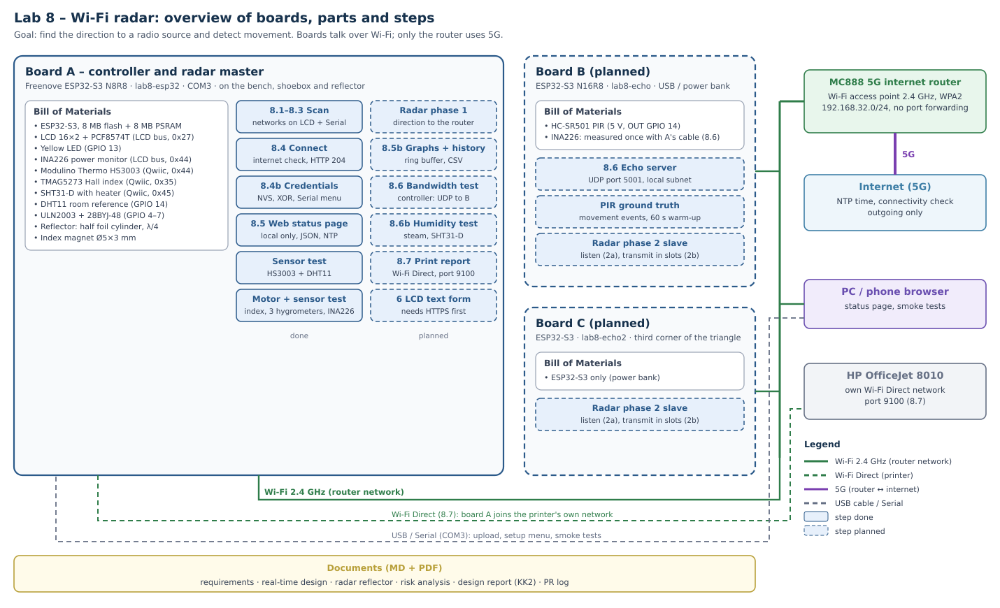

The rig consists of board A (controller, with LCD and sensors) and board B
(echo server for the bandwidth test, later with a PIR sensor), both on the
home's 5G router network. A PC is used for programming, smoke tests and the
browser. The HP printer is reached over its own Wi-Fi Direct network. Nothing
is reachable from the internet (no port forwarding).

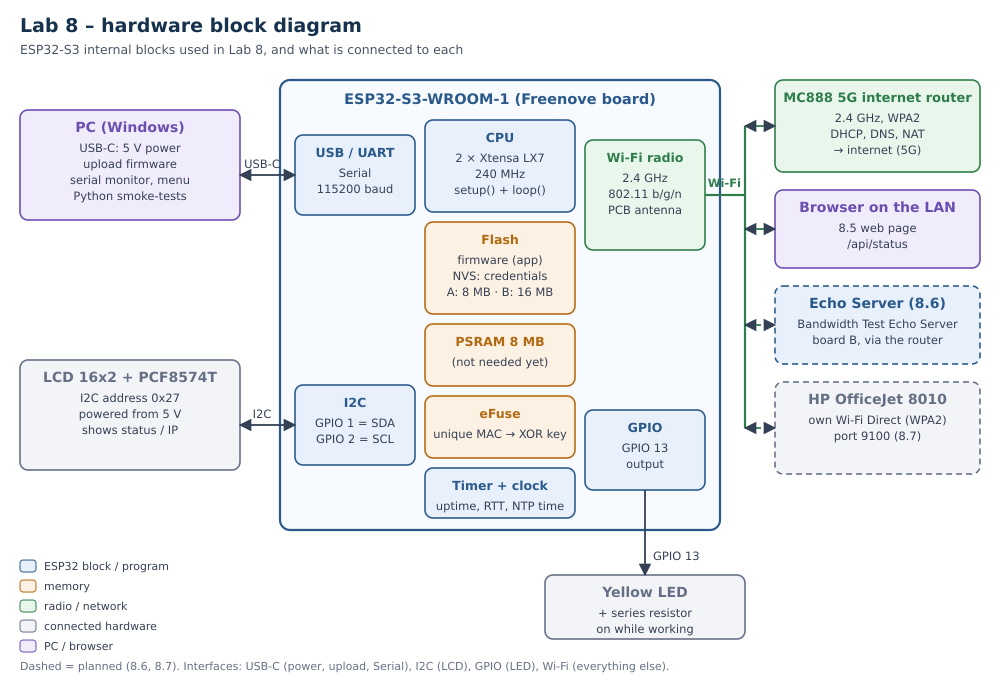

# 2. Step 2 – Requirements

The full specification is `lab8_wifi_requirements.md`: hardware (HW), functional
(FR), non-functional (NFR) and security (SEC) requirements, each with priority
(must/should/could), verification method and status. Summary:

## 2.1 Main functions and core value

| Area | Main function | Status |
|------------------|-----------------------------------------------------------------|-----------------|
| Scan (8.1–8.3) | List nearby 2.4 GHz networks, mark open ones | Verified |
| Connect (8.4, 8.4b) | Join the router, check internet every 30 s, credentials stored safely | Verified |
| Web status (8.5) | Local read-only status page and JSON, NTP clock | Verified |
| Sensors | Temperature and humidity from three sensors | Sensor test verified |
| Bandwidth (8.6) | Latency, losses, throughput, power per board | Planned |
| Print (8.7) | Scan report on the printer over Wi-Fi Direct | Planned (PC test passed) |
| Wi-Fi radar | Direction to the router, movement detection | Designed |

**Core value:** a low-cost Wi-Fi radar that finds the direction to a radio source and detects movement, built from safe, local and well-documented steps.

## 2.2 Functional requirements (examples)

1. The controller shall scan nearby networks every 15 s without joining any (FR-SCAN-1).
2. Internet access shall be checked every 30 s; a lost connection shall be re-established automatically (FR-CONN-3, FR-CONN-4).
3. The web page shall show connection data, scan results and NTP time, refreshed every 15 s (FR-WEB-1…5).
4. Each board shall measure its own current, voltage and power with an INA226 (HW-3, FR-BW-7).

## 2.3 Non-functional requirements (examples)

1. Measurement activities shall be time-triggered on UTC (NTP), never "interval since last time" (NFR-RT-4).
2. Every step with a testable interface shall have a Python smoke test (NFR-TEST-1).
3. No secret shall be committed to git or shown on any output (SEC-1, SEC-2).

## 2.4 User experience

| Aspect | Design |
|---------|-------------------------------------------------------------------------------------------|
| Feel | Quiet and trustworthy: read-only, no secrets shown, clear OK/FAIL |
| Usability | Visible display (LCD) at the rig; full detail in the browser; no app needed |
| Where | Locally: LCD and Serial at the rig, web page on the home network, printout on paper |

## 2.5 Platform

| Item | Choice |
|-------------|---------------------------------------------------------------------------------------|
| User interface | LCD 16×2 (I2C), yellow status LED, Serial (setup menu), web browser, printer |
| Operating system | FreeRTOS, through the Arduino-ESP32 core (ESP-IDF underneath) |
| Communication | Wi-Fi 802.11 b/g/n 2.4 GHz; HTTP, mDNS, NTP, raw TCP 9100 (print), UDP (8.6); I2C (two buses) and one-wire to sensors |
| Processor | ESP32-S3 (dual-core Xtensa LX7, 240 MHz); A: 8 MB flash + 8 MB PSRAM, B: 16 MB flash + 8 MB PSRAM |
| Toolchain | PlatformIO (VS Code), C++ (Arduino framework), Git and GitHub |

## 2.6 Development, verification and quality tools

| Area | Tool |
|------|-----------------------------------------------------------------------------------------------|
| Verification | Requirement IDs traced to tests (requirements spec, section 7) |
| Test | Python smoke tests over Serial and HTTP: `lab8_wifi_scan_smoke_test.py`, `lab8_wifi_connect_smoke_test.py`, `lab8_wifi_web_status_smoke_test.py`; manual tests on the board (router off/on) |
| Quality | One branch and pull request per step with test checklist; PR log; `git status` before every commit |
| CAD / diagrams | Block, wiring and timing diagrams generated as SVG by Python scripts |
| AI | Claude (Anthropic) supported coding, documentation and diagram creation. The ideas, concepts, analysis and design decisions are the author's own. The author reviewed and tested the code and made selected modifications and refinements. Git and GitHub repositories, including version control and project management, have been managed and controlled by the author (see Section 6). |

# 3. Step 3 – First rig and architecture

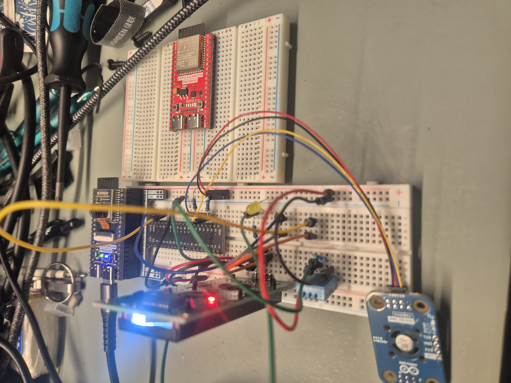

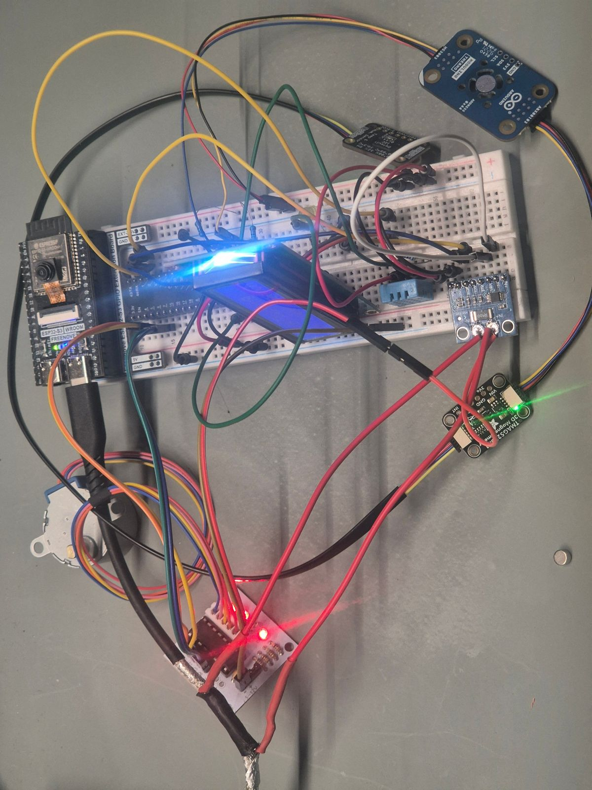

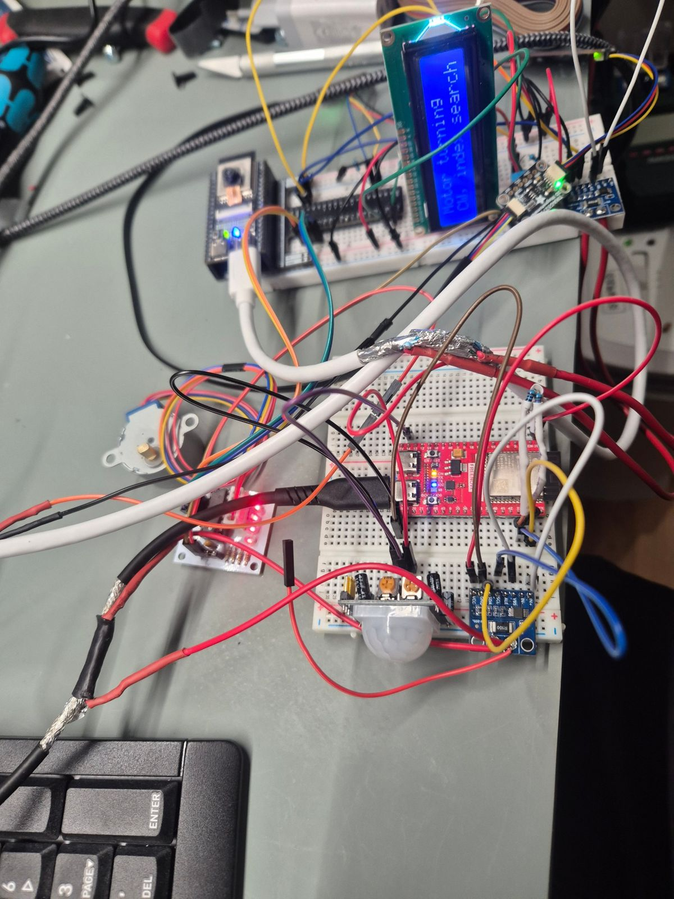

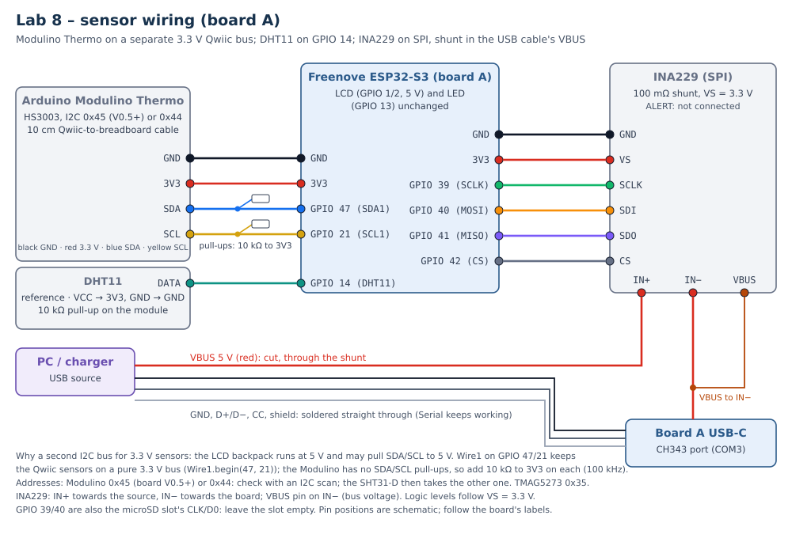

## 3.1 Sensors

| Sensor | Bus / pin | Place | Role |
|-------------------------|--------------------------|---------------|----------------------------------|
| Arduino Modulino Thermo (HS3003) | I2C `Wire1` (GPIO 47/21), 0x44 | Inside the box | Box climate and antenna conditions |
| DHT11 | One-wire, GPIO 14 | Above the box | Room reference |
| SHT31-D (with heater) | I2C `Wire1`, 0x45 | Above the steam | Steam humidity, recovery after drying |
| TMAG5273 3D Hall sensor | I2C `Wire1`, 0x35 | At the motor | Index (home position) for the reflector |
| INA226 power monitor (A and B) | I2C `Wire` (GPIO 1/2), 0x44; on B with its own 10 kΩ pull-ups | In each USB cable's 5 V wire | Current, voltage and power of each board |
| HC-SR501 PIR (board B) | GPIO, 5 V supply | In the room | Ground truth for movement |
| The ESP32's own radio | – | – | RSSI of beacons and packets |

The 3.3 V sensors have their own I2C bus: the LCD backpack runs at 5 V and may
pull its bus to 5 V. The sensors chain over Qwiic cables (10 + 10 + 40 cm).
The INA226 sits on the LCD bus instead, because its address 0x44 is taken by
the Modulino on the sensor bus.

## 3.2 Actuators

| Actuator | Use |
|-------------------------------------|---------------------------------------------------------------|
| Yellow LED (GPIO 13) | On while connecting or checking |
| 28BYJ-48 stepper motor + ULN2003 (GPIO 4–7) | Turns the reflector around the antenna (radar); 5 V from its own USB-C power cable (shared GND), not through the INA226 |
| HP printer (over Wi-Fi Direct) | Paper scan report |

## 3.3 User interface

LCD (status, IP address, sensor values), the web page (`http://lab8-esp32.local/`),
Serial (setup menu, machine-readable log lines) and the printout.

## 3.4 Software architecture

Each step is one commented source file in `src/`, selected in `platformio.ini`.
Common parts are in `include/` (credentials). Serial output is machine-readable
(`KEY value=…`), which is what the smoke tests parse. The planned measuring
system is time-triggered: every window starts at an absolute UTC time, so
several boards stay aligned without messages (`lab8_wifi_rt_design.md`).

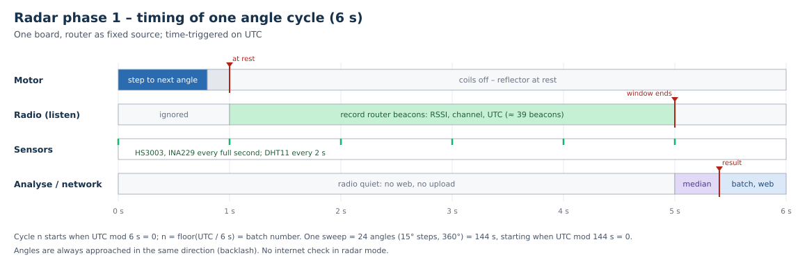

## 3.5 Analysis: beam width and direction accuracy

Professional radar steers a narrow beam; the PMWR turns a reflector. How
narrow can that beam be, and how precisely can the direction still be found?

**Beam width** is set by the size of the aperture D compared with the
wavelength λ (≈ 12.3 cm at 2.4 GHz):

$$\theta_{beam} \approx 70^\circ \cdot \frac{\lambda}{D}$$

| Design | Aperture D | Beam |
|-------------------------------------|---------------|------------------------------------------------|
| Half-cylinder, Ø 6.2 cm (the rig) | ≈ 6 cm, smaller than λ | Broad lobe: the front is a few dB stronger than the back |
| Closed foil cylinder with a narrow slot | A few mm to λ/4 | Not narrower: a small opening **widens** the beam, and openings much below λ/2 ≈ 6 cm pass little 2.4 GHz; the closed metal also detunes the antenna |
| Parabolic trough, antenna at the focus | ≈ 25–30 cm (2–2.5 λ) | About 30–35° in the turning plane |
| External directional antenna (ESP32-S3-WROOM-1U + cantenna or corner reflector) | ≈ 10–30 cm | About 40–60° |

**Conclusion:** the rig cannot form a narrow beam; that is a physical limit
of a reflector smaller than the wavelength, not a build quality issue. The
direction can still be estimated precisely, because the estimate does not
depend on the beam being narrow:

| Method | How | Hardware change |
|------------|--------------------------------------------------------------------------|--------------|
| Curve fit | A Gaussian fitted to all 24 angles; its centre θ₀ is located much more precisely than the lobe is wide | None |
| Edge (null) detection | The signal drops sharply where a foil edge passes the direction to the router; the midpoint of the two edges gives the direction | None; finer steps near the edges |
| Averaging | Median of about 40 beacons per angle, several sweeps | None |

So the honest summary is: **a broad beam, but a precise direction
estimate.** A narrow beam is the main improvement for the prototype (parabolic
trough or external antenna, section 5.10).

# 4. Step 4 – Execution and demonstration

## 4.1 Demo

1. Board A connects, shows "Internet OK" and its IP address on the LCD.
2. The web page shows connection data, nearby networks and NTP time.
3. The sensor test shows the HS3003 and the DHT11 side by side on the LCD.
4. Router off and on: the board reconnects by itself.

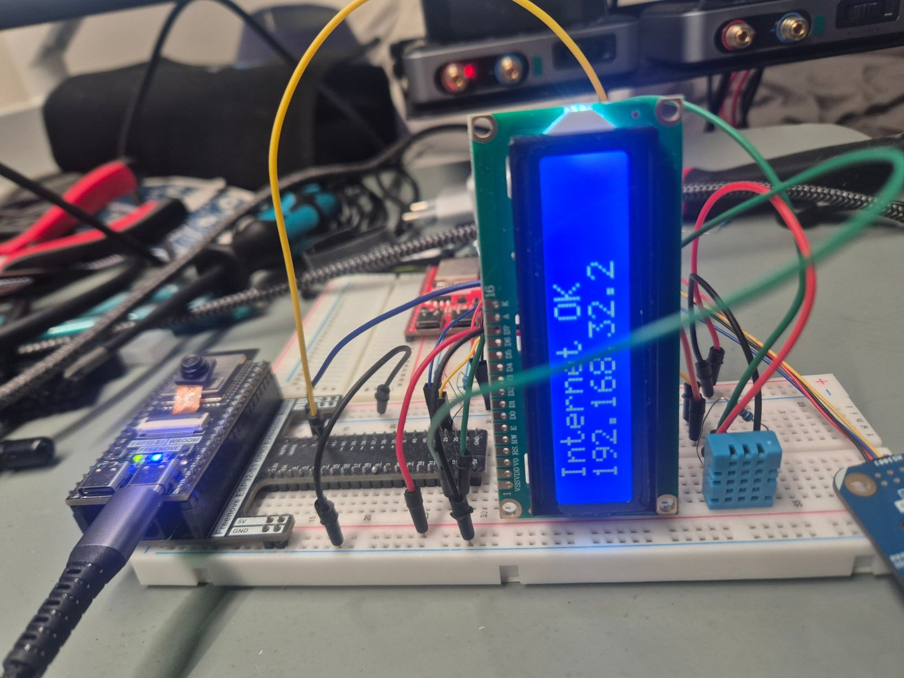

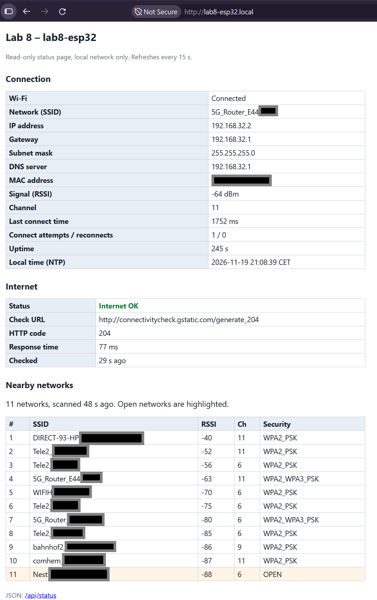{style="max-height:820px"}

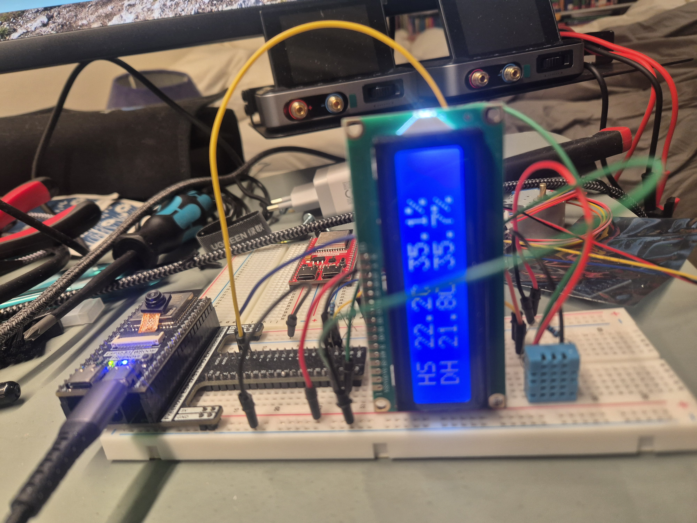

## 4.2 Code

| File | Step | Content |
|------------------------------------|-----------|----------------------------------------------------|
| `src/lab8_wifi_scan.cpp` | 8.1–8.3 | Scan, LCD cycling, Serial report |
| `src/lab8_wifi_connect.cpp` | 8.4, 8.4b | Connect, internet check, NVS credentials |
| `include/lab8_credentials.h` | 8.4b | Setup menu, XOR obfuscation, NVS |
| `src/lab8_wifi_web_status.cpp` | 8.5 | Web page, JSON, background scan, NTP |
| `src/lab8_sensor_test.cpp` | Sensors | I2C scan, HS3003 and DHT11 |
| `src/lab8_motor_and_sensor_test.cpp` | Motor and sensors | Motor back and forth, TMAG5273 index search, HS3003, SHT31-D, DHT11 and INA226 at rest |
| `tests/*.py` | 8.3–8.5 | Smoke tests |

## 4.3 Code example: `lab8_wifi_connect.cpp` (8.4, 8.4b)

This program joins the router network, checks internet access every 30 s and
reports the result on the LCD and on Serial. It shows the structure every
Lab 8 program follows: a header comment (what it does, hardware, Serial
protocol), constants with the `K…` prefix, small helper functions, one cycle
function, and `setup()`/`loop()`.

**Requirements implemented:**

| ID | Requirement |
|---------------|-------------------------------------------------------------------------------------|
| FR-CONN-1 | Join the configured network as host name `lab8-esp32` |
| FR-CONN-2 | Report IP, gateway, subnet, DNS, RSSI and channel; name and IP on the LCD |
| FR-CONN-3 | Check internet access every 30 s (HTTP 204 = OK) |
| FR-CONN-4 | Detect a lost connection and reconnect automatically |
| FR-CRED-1 | Credentials from NVS; setup menu over Serial |
| SEC-2 | The password is never printed |
| NFR-CODE-1…2 | One commented source file; machine-readable Serial lines |
| NFR-TEST-1 | Tested by `tests/lab8_wifi_connect_smoke_test.py` |

**Structure:**

| Part | Content |
|---------------|-------------------------------------------------------------------------------------|
| Header comment | Purpose, hardware (LCD on GPIO 1/2, LED on GPIO 13), the Serial protocol the smoke test parses |
| Constants | Pins, host name `lab8-esp32`, check URL, timeouts and the 30 s interval |
| LCD and Serial helpers | `showOnLcd()`, `formatForLcd()`, `printSsidAsHex()`, `printSsidAsText()`, `getWifiStatusName()` |
| Wi-Fi | `connectToWifi()`, `ensureWifiConnected()`, `reportWifiStatus()` |
| Internet check | `checkInternet()` |
| Cycle | `runCheckCycle()`: LED on → connect if needed → report → check → LED off |
| Entry points | `setup()`: LCD, credentials, host name; `loop()`: runs the cycle every 30 s |

**Flow:**

```
setup()  ─ LCD ─ load credentials from NVS (menu on 'c') ─ host name ─ station mode
loop()   ─ every 30 s ─► runCheckCycle()
                           ├─ ensureWifiConnected() ─► connectToWifi()  (if dropped)
                           ├─ reportWifiStatus()     IP, gateway, DNS, RSSI
                           └─ checkInternet()        HTTP GET → 204 = OK
```

**Joining the network** – the SSID and password come from NVS (8.4b), never
from the source. The SSID is printed as hex and as safe text; the password is
only passed to `WiFi.begin()`:

```cpp
// Join the router network stored in NVS. Returns true when connected.
bool connectToWifi() {
    // Nothing stored yet: tell the user how to fix it.
    if (!credentials.hasRouter()) {
        Serial.println("WIFI_CONNECT_FAIL status=-1 reason=NO_CREDENTIALS");
        showOnLcd("No WiFi config", "Reset, press c");
        return false;
    }
    const char* ssid = credentials.routerSsid.c_str();
    ...
    WiFi.disconnect();                    // Start from a clean state
    WiFi.begin(ssid, credentials.routerPassword.c_str());

    // Wait until connected or the timeout runs out.
    const uint32_t startMillis = millis();
    while (WiFi.status() != WL_CONNECTED &&
           millis() - startMillis < KWifiConnectTimeoutMillis) {
        delay(KWifiPollMillis);
    }
    ...  // on failure: WIFI_CONNECT_FAIL with the reason, and "WiFi FAIL" on the LCD
}
```

**Checking the internet** – an HTTP request to Google's connectivity-check
page; the answer 204 (No Content) means the internet works. The time is
measured, and the result is printed in the fixed format the smoke test reads:

```cpp
// Fetch the connectivity-check page. Returns true if it answered 204.
bool checkInternet() {
    ...
    const uint32_t startMillis = millis();
    int code = -1;
    if (http.begin(client, KCheckUrl)) {
        code = http.GET();               // < 0 means no answer (DNS, timeout...)
    }
    const uint32_t durationMillis = millis() - startMillis;
    http.end();

    const bool ok = code == KExpectedCode;
    Serial.print("HTTP_RESULT code=");
    ...
    showOnLcd(ok ? "Internet OK" : "Internet FAIL", detailLine);
    return ok;
}
```

**One cycle** – reconnecting is part of every cycle, which is how the board
recovers by itself after the router has been off (verified):

```cpp
void runCheckCycle() {
    digitalWrite(KPinStatusLed, HIGH);   // LED on: working
    Serial.println("CHECK_BEGIN");

    bool ok = false;
    if (ensureWifiConnected()) {
        reportWifiStatus();
        ok = checkInternet();
    }

    Serial.print("CHECK_END ok=");
    Serial.println(ok ? 1 : 0);
    digitalWrite(KPinStatusLed, LOW);    // LED off: idle
    lastCheckMillis = millis();
    firstCheck = false;
}
```

**Start-up** – the credentials are loaded from NVS; the setup menu opens if
none are stored or if `c` is pressed within 3 s. The host name must be set
before Wi-Fi starts, or the router shows the default name:

```cpp
    credentials = lab8::loadCredentials();
    if (!credentials.hasRouter() || lab8::setupRequested()) {
        lab8::runSetupMenu();
        credentials = lab8::loadCredentials();
    }
    WiFi.setHostname(KHostName);         // before WiFi.mode()
    WiFi.mode(WIFI_STA);                 // join a router as a normal client
```

**Loop** – the 30 s interval uses unsigned subtraction, which stays correct
when `millis()` wraps after 49 days. (The measuring programs for the radar
will instead start every window at an absolute UTC time, see the real-time
design.)

```cpp
void loop() {
    const bool checkIsDue = millis() - lastCheckMillis >= KCheckIntervalMillis;
    if (firstCheck || checkIsDue) {
        runCheckCycle();
    }
    delay(20);
}
```

## 4.4 Code: creating the web status page (`lab8_wifi_web_status.cpp`, 8.5)

The web page is built on top of the connect program (section 4.3): the same
connection, internet check and credentials, plus a web server, a background
scan and an NTP clock.

**Requirements implemented:**

| ID | Requirement |
|--------------|--------------------------------------------------------------------------------------|
| FR-WEB-1 | Status page at `http://<ip>/`, refreshed every 15 s |
| FR-WEB-2 | The same data as JSON at `/api/status` |
| FR-WEB-3 | Background scan every 60 s without disconnecting |
| FR-WEB-4 | Connect time, attempts, reconnections and uptime shown |
| FR-WEB-5 | NTP clock with Swedish time on the page and in JSON |
| SEC-4 | Reachable from the local network only |
| SEC-5 | Read-only (non-GET → 405); other subnets → 403 |
| SEC-6 | SSIDs escaped; no JavaScript; security headers |
| NFR-CLK-1 | Clock within 2 minutes of the PC once NTP is set |
| NFR-RT-1 | Nothing blocks the web server for long |
| NFR-TEST-1 | Tested by `tests/lab8_wifi_web_status_smoke_test.py` |

**Flow:**

```
setup()  ─ LCD ─ credentials ─ host name ─ connect ─► startWebServer()
                                                   ├─ routes: "/" and "/api/status"
                                                   ├─ mDNS: lab8-esp32.local
                                                   └─ startClock(): NTP, Swedish time
loop()   ─ server.handleClient()              every pass (a few ms)
         ─ runCheckCycle()                    every 30 s (internet check, reconnect)
         ─ startScan() / collectScanIfDone()  every 60 s, without disconnecting
request  ─ acceptRequest() ─ local subnet? ─ sendSecurityHeaders() ─ HTML or JSON
```

**Starting the server** – two routes, everything else answers 404 (or 405
for any method other than GET). The board also announces itself with mDNS,
so `http://lab8-esp32.local/` works without knowing the IP address:

```cpp
void startWebServer() {
    startClock();                         // NTP needs Wi-Fi, so start it here
    ...
    server.on("/", HTTP_GET, handleRoot);
    server.on("/api/status", HTTP_GET, handleApiStatus);
    server.onNotFound(handleNotFound);
    server.begin();

    if (MDNS.begin(KHostName)) {
        MDNS.addService("http", "tcp", KWebPort);
    }
    ...  // prints WEB_READY url=http://<ip>/ mdns=http://lab8-esp32.local/
}
```

**Only the local network** – a request is answered only if the client's
address is in the ESP32's own subnet (the same comparison a router makes):

```cpp
bool clientIsLocal() {
    const uint32_t mask   = static_cast<uint32_t>(WiFi.subnetMask());
    const uint32_t local  = static_cast<uint32_t>(WiFi.localIP());
    const uint32_t remote = static_cast<uint32_t>(server.client().remoteIP());
    return (remote & mask) == (local & mask);
}

bool acceptRequest() {
    if (!clientIsLocal()) {
        sendSecurityHeaders();
        server.send(403, "text/plain", "Forbidden: local network only\n");
        return false;
    }
    return true;
}
```

**Security headers** – every answer forbids scripts, framing, caching and
content-type guessing:

```cpp
void sendSecurityHeaders() {
    server.sendHeader("Cache-Control", "no-store");
    server.sendHeader("X-Content-Type-Options", "nosniff");
    server.sendHeader("X-Frame-Options", "DENY");
    server.sendHeader("Referrer-Policy", "no-referrer");
    // No scripts at all; only the page's own inline styles.
    server.sendHeader("Content-Security-Policy",
                      "default-src 'none'; style-src 'unsafe-inline'");
}
```

**Building the page** – the HTML is built as a string on every request,
refreshes itself every 15 s, and needs no JavaScript. Network names come from
strangers' routers and could contain `<script>`, so every SSID goes through
`escapeHtml()` before it is placed in the page:

```cpp
String buildStatusHtml() {
    ...
    html += "<meta http-equiv=\"refresh\" content=\"" + String(KPageRefreshSeconds) + "\">";
    ...
    html += htmlRow("IP address", WiFi.localIP().toString());
    html += htmlRow("Local time (NTP)", clockIsSet() ? localTimeText() : String("not set yet"));
    ...
    for (uint8_t index = 0; index < storedNetworkCount; ++index) {
        const NetworkInfo& network = storedNetworks[index];
        const bool isOpen = network.auth == WIFI_AUTH_OPEN;
        html += isOpen ? "<tr class=\"open\">" : "<tr>";      // open networks highlighted
        html += "<td>" + escapeHtml(safeSsid(network.ssid)) + "</td>";
        ...
    }
}

String escapeHtml(const String& text) {          // < > & " ' become harmless text
    ...
        case '&':  result += "&amp;";  break;
        case '<':  result += "&lt;";   break;
        case '>':  result += "&gt;";   break;
    ...
}
```

`buildStatusJson()` builds the same data as JSON for `/api/status` (with
`escapeJson()`), which is what the smoke test reads.

**Read-only** – any method other than GET gets 405:

```cpp
void handleNotFound() {
    ...
    if (server.method() != HTTP_GET) {
        server.sendHeader("Allow", "GET");
        server.send(405, "text/plain", "Method not allowed: read-only\n");
        return;
    }
    server.send(404, "text/plain", "Not found\n");
}
```

**Loop** – the server is served on every pass; the check and the scan run on
their own intervals and never stop it for long:

```cpp
void loop() {
    if (webStarted) {
        server.handleClient();
    }
    if (firstCheck || millis() - lastCheckMillis >= KCheckIntervalMillis) {
        runCheckCycle();
    }
    const bool scanDue = lastScanMillis == 0 ||
                         millis() - lastScanMillis >= KScanIntervalMillis;
    if (!scanRunning && scanDue && WiFi.status() == WL_CONNECTED) {
        startScan();
    }
    collectScanIfDone();
    reportClockIfNewlySet();
    delay(2);
}
```

## 4.5 Code: scanning nearby networks (8.1–8.3 and 8.5)

Scanning is done in two ways:

| Program | Scan | Why |
|-------------------------|-----------------------------------------|----------------------------------|
| `lab8_wifi_scan.cpp` (8.1–8.3) | **Blocking**, every 15 s, not connected to any network | Simple; nothing else has to run meanwhile |
| `lab8_wifi_web_status.cpp` (8.5) | **Asynchronous**, every 60 s, while staying connected | The web server must keep answering during the scan |

**Requirements implemented:**

| ID | Requirement |
|---------------|-------------------------------------------------------------------------------------|
| FR-SCAN-1 | Scan nearby 2.4 GHz networks every 15 s without joining any |
| FR-SCAN-2 | Report each network: SSID as hex and text, RSSI, channel, security |
| FR-SCAN-3 | LCD: number of networks, then each SSID, RSSI and channel |
| FR-SCAN-4 | Open networks clearly identified |
| FR-WEB-3 | Background scan in 8.5 without disconnecting |
| NFR-MEM-1 | At most 40 stored networks |
| NFR-TEST-1 | Tested by `tests/lab8_wifi_scan_smoke_test.py` and the web smoke test |

**Blocking scan (8.1–8.3)** – the board is in station mode but joined to no
network, so the scan sees everything and joins nothing. Hidden networks are
included:

```cpp
void scanNetworks() {
    digitalWrite(KPinStatusLed, HIGH);  // LED on: scan in progress
    showOnLcd("Scanning WiFi...", "2.4 GHz");
    Serial.println("SCAN_BEGIN");

    // async = false : wait here until the scan is done
    // showHidden = true : include networks that hide their SSID
    const bool kAsync      = false;
    const bool kShowHidden = true;
    const int16_t networkCount = WiFi.scanNetworks(kAsync, kShowHidden);

    if (networkCount < 0) {
        reportScanFailure(networkCount);
    } else {
        reportScanResults(networkCount);   // LCD: count, then each network;
    }                                      // Serial: one line per network
    WiFi.scanDelete();                  // Free the memory used by the results
    digitalWrite(KPinStatusLed, LOW);   // LED off: scan finished
    ...
}
```

`reportScanResults()` shows the count on the LCD, then each network's SSID,
RSSI and channel, and prints one machine-readable line per network on Serial,
between `SCAN_RESULT` and `SCAN_END`:

```cpp
// Print one "AP ..." line for the network at 'index'.
// Example: "AP index=0 ssid_hex=4869 ssid=homewifi rssi=-67 channel=6 auth=WPA2_PSK"
void printNetworkToSerial(int16_t index, const String& ssid) {
    Serial.print("AP index=");
    Serial.print(index);
    Serial.print(" ssid_hex=");
    printSsidAsHex(ssid);
    Serial.print(" ssid=");
    printSsidAsText(ssid);
    Serial.print(" rssi=");
    Serial.print(WiFi.RSSI(index));
    Serial.print(" channel=");
    Serial.print(WiFi.channel(index));
    Serial.print(" auth=");
    Serial.println(getAuthModeName(WiFi.encryptionType(index)));
}
```

The SSID is printed twice: as hex, so that spaces, symbols and non-ASCII
characters can never break the line or be misread, and as text for people,
where every non-printable character and the quote become `?`:

```cpp
void printSsidAsText(const String& ssid) {
    Serial.print('"');
    for (size_t position = 0; position < ssid.length(); ++position) {
        const uint8_t character = static_cast<uint8_t>(ssid[position]);
        const bool isPrintable = character >= 32 && character <= 126;
        const bool isQuote = character == '"';
        Serial.print(isPrintable && !isQuote ? static_cast<char>(character) : '?');
    }
    Serial.print('"');
}
```

`getAuthModeName()` turns the security mode into a name (`OPEN`, `WPA2_PSK`,
`WPA2_WPA3_PSK` …); `auth=OPEN` is how open networks are marked (FR-SCAN-4).

**Asynchronous scan (8.5)** – the scan is started and the function returns at
once; `loop()` keeps serving the web page and calls `collectScanIfDone()`,
which copies at most 40 results into a fixed array (NFR-MEM-1) when the scan
has finished:

```cpp
void startScan() {
    const bool kAsync      = true;
    const bool kShowHidden = true;
    WiFi.scanNetworks(kAsync, kShowHidden);
    scanRunning     = true;
    scanStartMillis = millis();
}

void collectScanIfDone() {
    if (!scanRunning) return;
    const int16_t result = WiFi.scanComplete();
    if (result == WIFI_SCAN_RUNNING) return;          // still scanning
    scanRunning = false;
    ...
    storedNetworkCount = result < KMaxStoredNetworks ? result : KMaxStoredNetworks;
    for (uint8_t index = 0; index < storedNetworkCount; ++index) {
        storedNetworks[index].ssid    = WiFi.SSID(index);
        storedNetworks[index].rssi    = WiFi.RSSI(index);
        storedNetworks[index].channel = WiFi.channel(index);
        storedNetworks[index].auth    = WiFi.encryptionType(index);
    }
    WiFi.scanDelete();
    ...  // prints SCAN_DONE count=<n>
}
```

## 4.6 Key functions in the other programs

| File | Key functions | Requirements |
|-------------------|---------------------------------------------------------------------|------------|
| `include/lab8_credentials.h` | `loadCredentials()`, `putSecret()` / `getSecret()`, `xorWithKeystream()`, `runSetupMenu()`, `setupRequested()`, `eraseCredentials()` | FR-CRED-1…4, SEC-1…3 |
| `src/lab8_wifi_web_status.cpp` (further) | `buildStatusJson()` / `escapeJson()`, `startClock()` / `reportClockIfNewlySet()`, `safeSsid()` | FR-WEB-2, FR-WEB-5, NFR-CLK-1 |
| `src/lab8_sensor_test.cpp` | `scanSensorBus()`, `readHs3003()`, `readDht11()` | HW-4, HW-8 |
| `src/lab8_motor_and_sensor_test.cpp` | `startMove()` / `finishMove()`, `sampleIndex()`, `setupTmag()` / `readTmagMagnitude()`, `readSht31()` (CRC-8), `setupIna()` / `readIna()`, `samplePower()`, `scanBus()` | HW-3, HW-7…10 |
| `tests/*.py` | Smoke tests: parse the Serial lines or the JSON and return exit code 0 on PASS | NFR-TEST-1 |

The full, commented source is in the repository.

## 4.7 Results

| Test | Result |
|-------------|---------------------------------------------------------------------------------------|
| Scan smoke test | PASS, 22 networks, 2 open |
| Connect smoke test | PASS, HTTP 204 in 82–300 ms |
| Web smoke test | PASS; no password in page or JSON; security headers present |
| Router off/on | Reconnected by itself (attempt 7) |
| Sensors | HS3003 21.94 °C / 35.4 % RH, DHT11 21.4 °C / 36.3 % RH: difference −0.54 °C / +0.9 % RH |
| Three hygrometers | HS3003 22.5 °C / 37 %, SHT31-D 22.3 °C / 36 %, DHT11 21.2 °C / 38 % RH |
| Motor | 4076 half steps per turn in 12.2 s, back to 0 every time |
| Index (TMAG5273) | Background 0.04 mT; the magnet gives up to 80 mT per axis |
| Power (INA226) | At rest 5.27 V / 85–90 mA / ≈ 450–470 mW. Motor through the shunt: 294 mA (max 390) / 1.5 W, and the voltage dipped to 5.11 V. Motor 5 V tapped before the shunt: ESP32 98 mA / 508 mW, still a 0.16 V dip (shared 1 m cable). Motor on its own USB-C cable: ESP32 98 mA / 514 mW, dip only 0.03 V (5.27 → 5.24 V). Board B (no LCD, no sensors): 5.30 V / 41.6 mA / 221 mW at rest. Preliminary: more data needed for KK3 (longer logging, Wi-Fi on) |

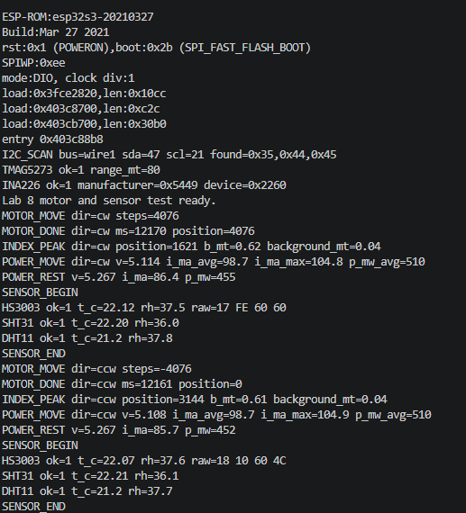

## 4.8 Problems and how they were solved

| Problem | Solution |
|---------------------------------|-------------------------------------------------------------------|
| Wi-Fi passwords would end up in the source code and on GitHub | Typed in once over Serial, stored in NVS, XOR-obfuscated with a key from the chip's MAC; AES with an eFuse key documented as the next level |
| SSIDs come from strangers and may contain HTML or script | Every SSID escaped for HTML and JSON; no JavaScript; Content-Security-Policy |
| SSIDs with hidden or non-printable characters | Printed both as text and as hex |
| A network scan would block the web server | Asynchronous scan every 60 s while staying connected |
| Reports and logs need correct time | NTP with Swedish time rule, non-blocking start |
| LCD bus at 5 V, sensors at 3.3 V | Separate 3.3 V I2C bus (`Wire1`) with 10 kΩ pull-ups; the Modulino has none of its own |
| Modulino and SHT31-D share the address 0x44 | SHT31-D set to 0x45 with its address jumper |
| The power monitor did not answer; the humidity of the Modulino read 1–2 % | The boards were INA226 (I2C), not INA229 (SPI), and at 0x44: the same address as the Modulino. Moved to the LCD bus, found by its ID |
| The motor's current made the power reading jump (294 vs 86 mA) and the voltage dip (0.16 V) | First the motor's 5 V was taken before the shunt (not measured, dip remained); then the motor got its own USB-C power cable from the KVM switch, with a shared GND: dip 0.03 V. A USB-C power-only cable gives 0 V from a USB-C charger (no CC resistor), so it is fed from a port that always gives 5 V |
| Board B's INA226 not found on the I2C bus | Swapping the INA226 modules showed the modules were fine. Board B has no LCD, so nothing pulled the bus up: 10 kΩ pull-ups added from GPIO 1/2 to 3V3. The last fault was a broken short jumper wire on SCL (GPIO 2): the line stayed at 3.3 V while the program ran |
| Measuring power without breaking Serial | Only the 5 V wire is cut through a window in the cable; data and ground untouched |
| Reflector angle: the motor axle is blocked at both ends | Index with a magnet and a 3D Hall sensor instead of an absolute encoder; self-calibration of steps per turn |
| `pio.exe` blocked by Windows Application Control | PlatformIO run through Python (`python -m platformio`) |
| Git line endings, wrong branch, merge conflicts in the PR log | Windows Git; one branch per step; conflicts resolved by keeping both sections |
| Phone photos of several MB, whose metadata can include the GPS position | Resized to 1600 px and all metadata removed before committing; checked: no GPS in the repo's photos |

# 5. Step 5 – Future prototype

## 5.1 Sketch

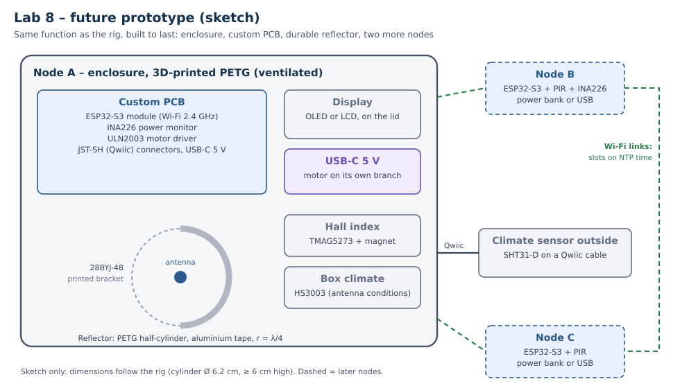

## 5.2 Material choices

| Part | Rig (today) | Prototype |
|---------|-----------------------------------------|-------------------------------------------------|
| Enclosure | Shoebox | 3D-printed PETG box, ventilated for the climate sensor |
| Wiring | Breadboard and jumper wires | Custom PCB with JST-SH (Qwiic) connectors |
| Reflector | 120 g paper cylinder with kitchen foil, on a paper cup adapter with a cardboard-reinforced bottom | PETG cylinder with aluminium tape, same λ/4 geometry |
| Mounting | Hot glue and tape | Screws and a printed motor bracket |

## 5.3 Environment

Low power (an ESP32 node draws well under 1 W, measured by the INA226: about 0.47 W at rest), USB
power, indoor use (0–40 °C). The climate sensor near steam needs protection
(conformal coating or a filter cap). Reusable modules on connectors instead of
soldered-in parts make repair and reuse possible; electronics are recycled as
e-waste.

## 5.4 First BoM sketch

Bought for the rig (prices in kr, incl. VAT):

| Qty | Item | Description | Use | Price (kr) | Source |
|------|--------------|-----------------------------------------------------|------------------|------|---------|
| 2 | ESP32-S3 | Freenove ESP32-S3 WROOM development board (2-pack), Wi-Fi 2.4 GHz | Board B and C | 279 | amazon.se |
| 2 | INA226 | Current, voltage and power monitor board (I2C), 100 mΩ shunt; with Qwiic 150 mm cable to pins | Power measurement on A and B | 217 | amazon.se |
| 1 | Modulino Thermo | Arduino temperature and humidity sensor board, HS3003 (I2C, Qwiic) | Box climate | 89 | Kjell & Company |
| 1 | SHT31-D | Temperature and humidity sensor board with built-in heater (I2C, Qwiic) | Steam humidity | 219 | Electrokit |
| 1 | TMAG5273 | 3D Hall-effect magnetic sensor board (I2C, Qwiic) | Radar index | 92 | Electrokit |
| 1 | Magnet | Neodymium disc magnet Ø5×3 mm | Radar index | 24 | Electrokit |
| 1 | Qwiic cable | JST-SH 4-pin cable, 100 mm | Sensor chain | 24 | Electrokit |
| 1 | Qwiic cable | JST-SH 4-pin cable, 300 mm | Sensor chain | 38 | Electrokit |
| 1 | Qwiic cable | JST-SH 4-pin cable, 400 mm | Sensor chain (SHT31-D) | 39 | Electrokit |
| 1 | USB cable | USB-A to USB-C cable, 1 m | Cut for the INA226 shunt | 159 | Kjell & Company |
| 2 | Breadboard | Solderless breadboard | For the extra ESP32 boards | 69 | Kjell & Company |
| 40 | Jumper wires | Male–male jumper wires, 20 cm | Wiring | 72 | Kjell & Company |
| 1 | Electronics kit | Assorted components (Kjell) | Spare parts | 209 | Kjell & Company |
| 1 | Freenove kit | Freenove ESP32-S3 starter kit; the parts used are listed below | See below | 699 | amazon.se |
| (1) | ESP32-S3 | Freenove ESP32-S3 WROOM N8R8 development board (in the kit) | Board A | (kit) | |
| (1) | LCD 16×2 with PCF8574T | Character display with I2C backpack (in the kit) | Status and values | (kit) | |
| (1) | DHT11 | Temperature and humidity sensor module (in the kit) | Room reference | (kit) | |
| (1) | HC-SR501 | Passive infrared (PIR) motion sensor (in the kit) | Ground truth on board B | (kit) | |
| (1) | 28BYJ-48 + ULN2003 | 5 V stepper motor with Darlington driver board (in the kit) | Turns the reflector | (kit) | |
| – | Resistors, LED | 10 kΩ resistors, yellow LED (in the kit) | Pull-ups, status LED | (kit) | |
| | **Total for the project** | | | **2 229** | |

Mechanics from home (no extra cost): shoebox, paper cup, 120 g paper, cardboard, kitchen
foil.

Tools (soldering iron, multimeter, heat shrink) are not part of the BoM.

## 5.5 Lessons from the rig

- Test each step on the board before moving on; a smoke test catches regressions (8.5 still passes the 8.4 test).
- Keep secrets out of files from the start; retrofitting is harder.
- Check bus voltages and addresses before connecting sensors.
- Documentation and diagrams are cheapest when updated in the same pull request as the code.

## 5.6 What the prototype should include

Within the time frame of KK2, the work was prioritised on a tested
foundation: connection, credentials, web page, sensors, power measurement
and motor. The features below are designed and documented, but deliberately
left for KK3 and the prototype:

| Feature | Why | Planned for |
|-----------------------------------|----------------------------------------------------------|-------|
| Radar phase 1: reflector on the motor, direction to the router | The lab goal; the hardware is verified | KK3 |
| Graphs on the web page (8.5b) | See trends in RSSI, climate and power without a PC | KK3 |
| Node B: echo server and PIR (8.6) | Bandwidth test with power on both boards, and ground truth for movement (INA226 and PIR already wired on B) | KK3 |
| DHCP reservations | Fixed addresses, so the boards always find each other | KK3 |
| Data collector with ACK/NACK and store-and-forward | No measurement lost when Wi-Fi drops | Prototype |
| Node C, radar phase 2 | Find *where* the movement is, not only that it happened | Prototype |
| HTTPS with an own certificate authority | Required before the page accepts input (the LCD text form) | Prototype |
| Over-the-air updates | Update the boards without a USB cable once they are in the enclosure | Prototype |

## 5.7 Cost aspects

Most cost is in the sensors and the mechanics; one ESP32 node is cheap. A
custom PCB pays off only from a handful of units. Tools (soldering iron, multimeter)
are one-time costs.

## 5.8 Safety aspects

| Area | Aspect | Measure |
|----------|-------------------------------|-----------------------------------------------------------|
| Electrical | USB 5 V only; the cut USB cable | Insulated joints, strain relief, test on a charger before a PC |
| Mechanical | Turning reflector | Slow (≤ 15 rpm), low torque, inside the enclosure |
| Heat | Steam and hot water in the humidity experiment | Stable thermos, sensor above the steam, no water near electronics |
| Data and privacy | Presence detection is personal data | Local only, no cloud, inform people in the room |
| Network | Devices on the home network | Read-only page, local subnet only, no port forwarding, VPN for remote access |

## 5.9 Value of a future prototype

A self-contained, safe network and climate monitor for a home or a remote
building, with presence detection without cameras.

## 5.10 Areas for research, development and tests

- How well RSSI alone detects movement compared with channel state information (CSI).
- How much humidity and steam really affect a 2.4 GHz link (experiment 8.6b).
- **Beam width – the biggest factor for direction accuracy** (analysis in
  section 3.5): build and compare a parabolic trough (≈ 25–30 cm, about
  30–35°) and an external antenna (ESP32-S3-WROOM-1U with a cantenna or
  corner reflector); test edge (null) detection with the existing
  half-cylinder first, since it needs no new hardware.
- Reflector geometry (height, distance, foil angle) and the accuracy of the
  direction estimate.
- Privacy and ethics of Wi-Fi sensing; acceptance in the target group.
- Target group survey: which measurements are actually useful at home.

# 6. Step 6 – Submission

| Item | Where |
|--------------|--------------------------------------------------------------------------------------|
| Design description | This report and the documents in section 0 |
| Code | `src/` and `include/`, commented, with references to the requirement IDs and the plan |
| Git repo | `TorstenssonGIT/ESP32-freenove-projects`, branch and pull request per step |
| Running rig | Board A with LCD, sensors and web page (photos in section 3 and 4) |

**AI Assistance:** This project was developed with assistance from Claude
(Anthropic), which supported coding, documentation and diagram creation.
The ideas, concepts, analysis and design decisions are the author's own. The
author has reviewed and tested the code, made selected modifications and
refinements, and clarified comments where appropriate.
Git and GitHub repositories, including version control and project
management, have been managed and controlled by the author.

**Intellectual Property Rights:** All intellectual property rights (IPR) in
the project, including its concepts, design, architecture, source code,
documentation and associated materials, are owned by the author. The use of
AI assistance does not transfer ownership of these rights to Anthropic or any
other third party.
