# Lab 8: Wi-Fi on the ESP32-S3

## Goal

**A "Wi-Fi radar" to find the direction to a radio source and detect
movement: the Passive Mechanical Wi-Fi Radar (PMWR).**

### Inspiration

The idea came from an article about detecting drones with 4G and 5G networks:
commercial cellular networks can be used as **passive radar**, without
emitting any new signals, because moving objects disturb the radio waves that
are already there. The same principle should apply to Wi-Fi, and it can be
enhanced with a moving antenna.

Professional systems use multi-antenna phased arrays that steer the beam
electronically in microseconds: expensive, complex and impossible to build
from scratch in a short time. This project therefore has to use something that
can realistically be created in a few weeks from off-the-shelf parts: the
**Passive Mechanical Wi-Fi Radar (PMWR)** replaces electronic beam steering
with mechanical rotation.

### Concept

A stationary Wi-Fi router is the radio source (the illuminator). A reflector
(120 g paper lined with 0.014 mm aluminium kitchen foil, half a cylinder,
λ/4 = 3.1 cm from the antenna) is turned by a stepper motor around the ESP32's
antenna:

- **Direction:** the router's signal strength at each angle gives a curve
  whose centre points to the router.
- **Movement:** increased RSSI variance compared with an empty-room baseline
  shows that something moves in the radio path.
- **Where:** later, boards B and C listen and transmit in NTP-timed slots, so
  the disturbed links show the sector.

The reflector gives a broad beam, not a narrow one; the direction is found by
curve fitting and edge detection (analysis: design report, section 3.5).

The goal has grown step by step. The lab started with scanning, connecting and
printing; each step became a building block for the radar:

| Building block | Steps |
|---|---|
| See the Wi-Fi environment | 8.1–8.3 scan |
| Reliable connection, safe credentials | 8.4, 8.4b |
| Local status page, NTP time | 8.5 |
| Climate sensors, power measurement | Sensor test, INA226 |
| Motor and index sensor | Motor and sensor test |
| Direction finding and movement | Radar phase 1 (KK3), phase 2 with boards B and C |

Design report (KK2): [`lab8_kk2_design_report.md`](lab8_kk2_design_report.md)
([PDF](lab8_kk2_design_report.pdf)).

### Way of working

Learn the ESP32-S3's built-in Wi-Fi features one step at a time. Reuse the LCD
already connected to the board to show progress and results. Add a small
Python test for each feature when that feature is implemented. Analyse the
security of each step: which data needs protection, which measures are taken,
and which risks are accepted (see
[`lab8_wifi_security_analysis.md`](lab8_wifi_security_analysis.md)).

The ESP32-S3 has Wi-Fi built in; no external Wi-Fi module is needed. Its radio
is **2.4 GHz only**, so the whole lab, including the radar, is locked to the
2.4 GHz band (the reflector is sized for λ ≈ 12.3 cm).

## Test network

Use the ZTE MC888 Pro 5G router as the Lab 8 test router. Its Wi-Fi is
configured for 2.4 GHz and it has internet access over 5G. The router has two
roles:

| Role | Use |
|---|---|
| **Network** | Board A joins as host name `lab8-esp32` and board B as `lab8-echo` (8.6); internet check, NTP time, status page. The credentials are entered once over the Serial setup menu and stored on the board (see "How Wi-Fi credentials work"). |
| **Radio source for the radar** | Its beacons (about ten per second) are the signal the PMWR measures. It stands still, about 3 m away in another room; its direction from board A is measured once with a protractor as the reference. |

The initial scan only lists nearby networks and does not require joining or
changing the router configuration. When testing feature 2, connect a phone
(and optionally another device) to the router, then compare the router's
client list with the devices that were deliberately connected.

The printer (feature 4, step 8.7) is reached through its own Wi-Fi Direct
network (`DIRECT-93-HP OfficeJet 8010`), which has no internet access.

## Agreed feature list
| # | Feature | Planned result | Status |
|---|---|---|---|
| 1 | Scan nearby 2.4 GHz Wi-Fi networks | Show scan status/count on the LCD, then cycle through each SSID (up to 16 characters), RSSI, and channel; list full details and security mode on Serial, clearly identifying open networks. Do not automatically join discovered networks. | Done. 8.1: readable code + credentials template. 8.2: readable SSID on Serial. Board tested: 12 networks (MC888 Pro off), later 19. |
| 1b | Python smoke-test for the scan | `lab8_wifi_scan_smoke_test.py` reads one scan from Serial and validates counts, SSID, RSSI, channel and auth mode; lists open networks. | Done (8.3): PASS on COM3, 22 networks, 2 open. |
| 2 | List and classify clients on an authorized network | Use an appropriate, authorized source for the network's client list. Do not attempt to access devices or networks without permission. | Done (manual): the router's client page lists device name, MAC address, IP address, Wi-Fi band and manage/block actions. `lab8-esp32` (192.168.32.2) and `lab8-echo` (192.168.32.6) are listed by host name on 2.4 GHz; no wired clients. Other household devices are not part of the test and are cropped from the screenshot. |
| 3 | Connect to an internet webpage | Join the configured 2.4 GHz network as host name `lab8-esp32`; report IP, gateway, subnet and DNS on Serial and name + IP on the LCD; check `http://connectivitycheck.gstatic.com/generate_204` (HTTP 204 = internet OK) every 30 s. | Done (8.4): connected as `lab8-esp32` (192.168.32.6, DNS 192.168.32.1), HTTP 204 in ~300 ms; smoke-test PASS on COM3; router off shows "WiFi FAIL" and recovers. 8.4b: credentials moved to NVS (XOR-obfuscated), entered via Serial menu; smoke-test PASS. |
| 3b | Web status page on the ESP32 | Serve `http://<esp-ip>/` and `http://lab8-esp32.local/` with the latest scan result and connection/internet status (hostname, IP, gateway, subnet, DNS, HTTP result); `/api/status` returns JSON for the Python smoke-test. Feature 6 later adds the LCD text form to this same server. | Done (8.5): page at `http://<ip>/` and `http://lab8-esp32.local/`, JSON at `/api/status`; read-only, local subnet only, SSIDs escaped; connect time / reconnects / uptime and NTP local time shown; web smoke-test, 8.4 smoke-test and router off/on PASS. |
| 4 | Print a scan report on the HP printer over Wi-Fi | Target printer: HP OfficeJet 8010 series, reached through its Wi-Fi Direct network. The ESP32 scans nearby networks, then sends a plain-text report to port 9100 (JetDirect/raw), ending with a form feed. Each network: SSID as ASCII text and as hex (same as `ssid="…"` and `ssid_hex=` on Serial; non-printable characters as `?` in the text), RSSI, channel, security; open networks marked. | PC test passed: plain text to port 9100 over Wi-Fi Direct printed correctly (no PCL needed). ESP32 firmware planned (8.7). |
| 5 | Run a Wi-Fi bandwidth test | Use a controlled endpoint and a bounded test; show the result/status on the LCD. | Done (8.6, router mode): one firmware `lab8_bandwidth.cpp`, role set by a jumper (GPIO 42 to GND = echo server B). 100 UDP packets per size 32–1460 B: 0 lost in two runs, median RTT 5.4–8.3 ms, up to 2.7 Mbit/s; A ≈ 0.93 W, B ≈ 0.67 W during a series. Now 3 legs: A measures against both echo servers, B (`lab8-echo`, .51) and C (`lab8-echo2`, .52), one series each (`node=B`/`node=C`). Terminal evidence for all three boards is the combined capture under *Board C*. Each run is NTP-timestamped and the web page shows one graph per packet size (throughput + RTT over the last 20 runs). Direct mode planned. **8.7 performance test added:** windowed UDP burst (`w`, v8.7.0) measures the ESP's real throughput/loss/jitter — ESP ~11 Mbit/s vs link ~40–48 Mbit/s (iperf3); the `r` 3 Mbit/s is a stop-and-wait artefact, not the link. See the performance section below. |
| 6 | Browse to the ESP32 and type text for the LCD | Serve a basic page from the ESP32; submitted text is shown on the existing LCD. This is a simple browser page, not a phone app. | Planned |
| 7 | Wi-Fi radar: direction and movement | Find the direction to the router with a motor-turned reflector around the antenna; detect movement from changes in signal strength (see `lab8_radar_reflector.md`, `lab8_wifi_rt_design.md`). | Hardware verified: motor (4076 half steps per turn) and TMAG5273 index. Reflector and radar firmware: phase 1 planned (KK3). Movement monitor (phase 2a, first result 2026-11-22): B reports its router RSSI, PIR and power to A every second; movement on one leg of the V changes only that board's link (see "Movement monitor test"). |
| 8 | Climate sensors, power measurement and motor | Read the HS3003 (box), SHT31-D (steam) and DHT11 (room); measure voltage, current and power with the INA226; turn the motor and find the index with the TMAG5273. | Motor and sensor test done: HS3003 (0x44), SHT31-D (0x45) and DHT11 agree within about 1.5 °C / 2 % RH; TMAG5273 index works; INA226 at rest 5.27 V / 86–90 mA / ≈ 460 mW; motor 4076 half steps per turn. SHT31-D heater and DHT11 recovery check pending. |

## Build and test approach

Implement one feature at a time. For each step:

1. Agree on the wiring, inputs, and expected LCD/serial output.
2. Implement the feature in its own Lab 8 source file.
3. Build and test it on the ESP32-S3 before moving on.
4. Add a focused Python smoke-test when a testable interface exists.
5. Update this plan with the result and any remaining issues.

Feature 1 is implemented in `lab8_wifi_scan.cpp`. The ESP32 scan found 12
nearby networks with the MC888 Pro switched off. The LCD cycles through each
network's SSID, RSSI, and channel after each scan. The serial output includes
`auth=OPEN` for networks without Wi-Fi security; connecting is a separate step
and is limited to networks the user owns or has permission to use.

Smoke-tests are run from the PlatformIO Core CLI terminal (its Python includes
`pyserial`) with the serial monitor closed, e.g.
`python tests/lab8_wifi_connect_smoke_test.py --port COM3`.

`platformio.ini` selects the program with `build_src_filter`; only one line
may be active. When a change touches several programs, build each one.

Feature 3b (8.5) is implemented in `lab8_wifi_web_status.cpp`. The page is
served at `http://<ip>/` and `http://lab8-esp32.local/`, with JSON at
`/api/status`. It is read-only (other methods give 405) and only answers the
local subnet (others give 403). SSIDs are HTML/JSON-escaped and the page has
no JavaScript. It shows connect time, reconnects, uptime and the local time
from NTP (CET/CEST). The web smoke-test runs over the network instead of
Serial, e.g.
`python tests/lab8_wifi_web_status_smoke_test.py --host lab8-esp32.local`.

The sensor test is implemented in `lab8_sensor_test.cpp`. It scans the 3.3 V
I2C bus at start and then reads the Modulino Thermo (HS3003) and the DHT11
every 2 s, printing both values and their difference on Serial and the LCD.
No Wi-Fi is used. Wiring: `lab8_wiring_sensors.svg`.

The motor and sensor test is implemented in `lab8_motor_and_sensor_test.cpp`.
The motor turns one revolution clockwise and back; while it turns, the
TMAG5273 looks for the index magnet; at rest (coils off) the three
hygrometers and the INA226 are read. Both I2C buses are scanned at start. A
demo mode shows one value per LCD screen for filming.

## Existing hardware to reuse

- ESP32-S3 board with built-in 2.4 GHz Wi-Fi.
- Existing 16x2 LCD with PCF8574T I2C adapter:
  - SDA: GPIO 1
  - SCL/SCK: GPIO 2
  - I2C address: `0x27`
- Existing yellow LED: GPIO 13.

Keep the LCD wiring unchanged. NEXT and OK buttons are intended for stepping
through tests and confirming selections; select safe, unused GPIO pins before
adding button wiring. The photoresistor from Lab 6B (GPIO 4) is removed:
GPIO 4–7 now drive the motor.

## Actuators and Sensors (board A)

| Device | Connection | Notes |
|---|---|---|
| Arduino Modulino Thermo (HS3003) | 3.3 V I2C bus `Wire1`: SDA GPIO 47, SCL GPIO 21, 10 kΩ pull-ups to 3V3 | 0x44; inside the box: box climate and antenna conditions |
| TMAG5273 3D Hall sensor | Same bus, Qwiic chain after the Modulino | 0x35; reflector index |
| SHT31-D (heater) | Same bus, last in the chain (40 cm) | 0x45 by address jumper; above the steam |
| DHT11 (blue module, 4 pins) | DATA GPIO 14, VCC 3V3, GND | Room reference; 10 kΩ pull-up on the module |
| INA226 power monitor | LCD bus `Wire`: SDA GPIO 1, SCL GPIO 2, VCC 3V3 | 0x44 (taken by the Modulino on `Wire1`); VBUS of the USB cable through the 100 mΩ shunt, VBS to IN− |
| 28BYJ-48 + ULN2003 | IN1–IN4 on GPIO 4–7 (camera unplugged); + from its own USB-C power cable; − to GND (shared) | Not measured by the INA226; voltage dip while turning 0.03 V |

Wiring: `lab8_wiring_sensors.svg`. Test: `lab8_motor_and_sensor_test.cpp`.

Board A uses two I2C buses:

- **LCD bus** (`Wire`, GPIO 1/2): the LCD backpack (0x27, 5 V) and the INA226
  (0x44). The backpack may pull this bus to 5 V; the INA226's SDA/SCL pins
  tolerate up to 6 V, so it can share it.
- **Sensor bus** (`Wire1`, GPIO 47/21, 3.3 V, 10 kΩ pull-ups): the Qwiic
  sensors, which must not see 5 V. The INA226 cannot sit here because its
  address 0x44 is the same as the Modulino's.

## Diagrams

Wiring of board A for 8.1–8.5 (LCD and LED):

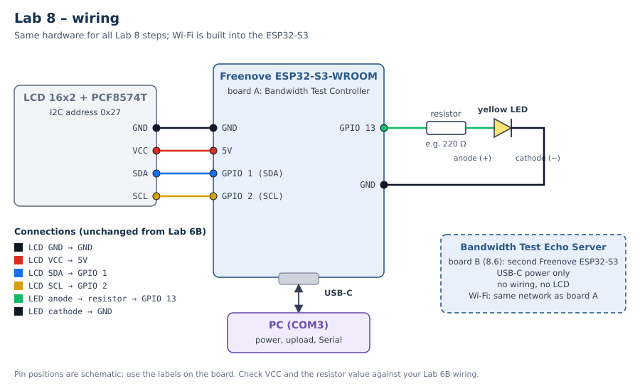

Wiring of board A with sensors, power monitor and motor (verified):

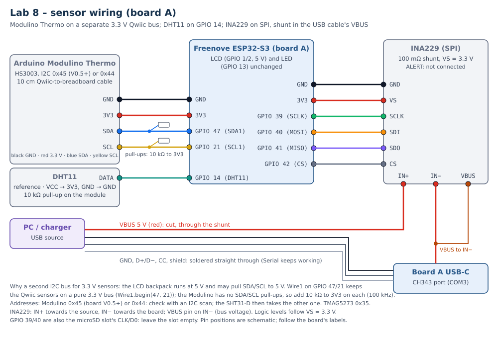

Hardware blocks (ESP32-S3 internals and what is connected to each):

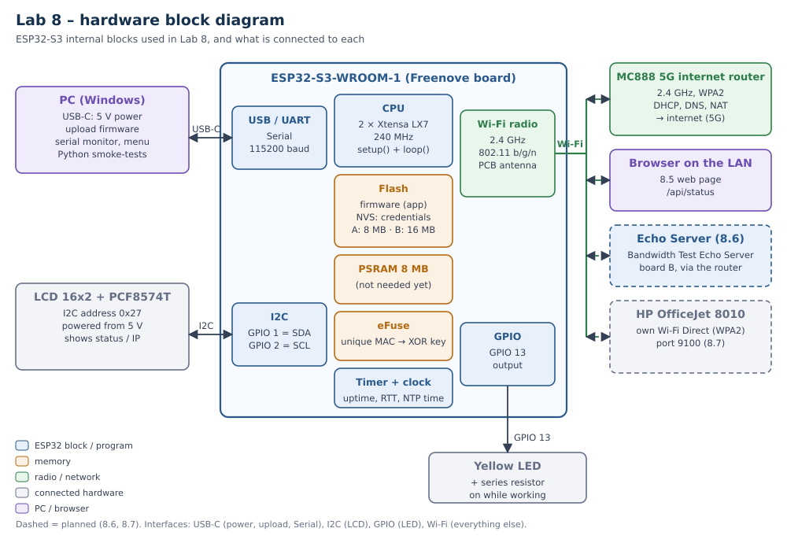

Overview of the steps:

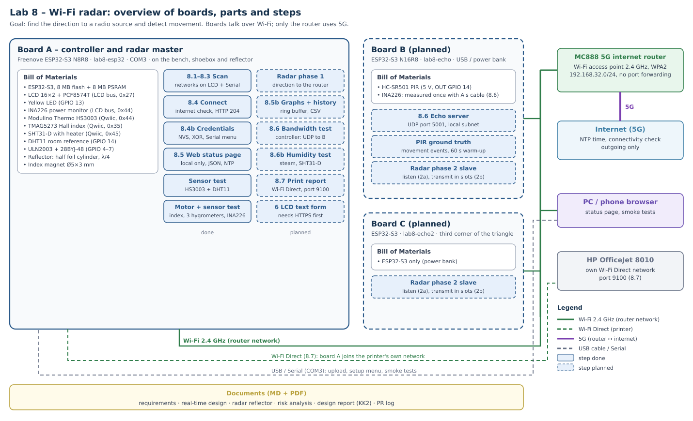

| Step | Block diagram |
|---|---|
| 8.1–8.3 Scan | [lab8_block_8_1_scan.svg](lab8_block_8_1_scan.svg) |
| 8.4 Connect + internet check | [lab8_block_8_4_connect.svg](lab8_block_8_4_connect.svg) |
| 8.4b Credentials in NVS | [lab8_block_8_4b_credentials.svg](lab8_block_8_4b_credentials.svg) |
| 8.5 Web status page | [lab8_block_8_5_web.svg](lab8_block_8_5_web.svg) |
| 8.6 Bandwidth test | [lab8_block_8_6_bandwidth.svg](lab8_block_8_6_bandwidth.svg) |
| 8.7 Print report (planned) | [lab8_block_8_7_print.svg](lab8_block_8_7_print.svg) |

Future prototype (sketch): [lab8_future_prototype.svg](lab8_future_prototype.svg)

## How Wi-Fi credentials work

Credentials are not stored in any file. They are typed in once over Serial
and saved in the ESP32's flash memory (NVS).

    You type in the serial monitor
            │
            ▼
    lab8_credentials.h  ── XOR with chip-specific key ──►  ESP32 flash (NVS)
                                                                 │
    Every boot: read from flash ── XOR back ──► RAM ──► WiFi.begin()

### First time on a board

1. Upload a Lab 8 Wi-Fi program and open the serial monitor
   (`pio run -t upload -t monitor`).
2. The flash is empty, so the setup menu opens by itself.
3. Choose `1` and type the router SSID and password (the password shows as `*`).
4. Optionally choose `2` for the printer's Wi-Fi Direct network, IP and port.
5. Choose `0`. The board connects.

### After that

- Nothing to do: the credentials survive power off, reset and new uploads.
- To change them: reset the board, press `c` within 3 s, use the menu.
- Menu `3` shows what is stored (passwords only as "set, hidden").
- Menu `4` or `pio run -t erase` deletes them; then repeat "First time".

### Files

| File | Contains | In git |
|---|---|---|
| `include/lab8_credentials.h` | Code: menu, XOR, flash read/write. No passwords. | Yes |
| ESP32 flash (NVS) | SSIDs and passwords, XOR-obfuscated | No (only on the board) |

## Details to confirm before later features

- Printer (resolved): the ESP32 joins the printer's Wi-Fi Direct network
  (`DIRECT-93-HP OfficeJet 8010`, printer at 192.168.223.1). Plain text sent to
  port 9100 prints directly, verified from the PC with `nc`. Open question for
  8.7: no internet on Wi-Fi Direct, so the report has no date unless the time
  is fetched (NTP) on the router network first.
- Client list (resolved): read from the router's own client page (own network,
  authorized); MAC addresses and personal device names are not documented.
- Bandwidth test (resolved): board B is the controlled endpoint (UDP echo on port 5001, local subnet only, max 1460 B); each series is 7 × 100 packets.
- Credentials are entered over Serial and stored in NVS (see "How Wi-Fi
  credentials work"); no credentials file is used. `.gitignore` still covers
  `include/wifi_credentials*.h` as a safety net.
- Commit the exercise source and tests after they pass. Keep Wi-Fi passwords,
  printer claim codes, account credentials, and other private network details
  local; never commit them. Check `git status` before every commit.
- mDNS (`lab8-esp32.local`) may be blocked by some routers or guest
  networks; the IP shown on the LCD is the fallback address.

## Movement monitor test (phase 2a, first result)

Firmware: `lab8_bandwidth.cpp` (same build on both boards, role jumper GPIO 42 on B).
On A, `m` starts the monitor. Both boards read the router's RSSI every 100 ms;
each 1 s window gives a median and a spread (standard deviation). A asks B and C
`MEAS?` every second; each answers with its window, its PIR (B only, ground
truth) and its power. A prints one `MOVE` line per second for all links, and its
web page shows three links (A, B, C).

**Layout (2026-11-22).** The links form a V with the router at the point:

| Unit | Place | From the outer wall | From the router |
|---|---|---|---|
| Router (ZTE MC888 Pro) | living room | ≈ 3.5 m | – |
| A (`lab8-esp32`) | desk | ≈ 1.2 m | ≈ 4.5 m |
| B (`lab8-echo`, power bank, PIR) | on the washing machine (bathroom) | ≈ 5 m | ≈ 14 m |

**Result (1 s windows, averaged per period):**

| Period | A–router | B–router | B's PIR | Reading |
|---|---|---|---|---|
| Still | −61 dBm, spread ≈ 0.4 dB | −56 dBm, spread ≈ 0.1 dB | partly active (B being placed) | baseline |
| Walking across A's leg | level down to −64…−65 dBm | unchanged, −56 dBm | quiet | only A's link reacts |
| Walking across B's leg | stays low, ≈ −65 dBm | spread up to 2.8–4.8 dB, level down to −60.7 dBm | active | B's link reacts |

- Movement on one leg of the V changes only that leg's link, so the link that
  reacts gives the direction of the movement from the router. An obstruction
  near the router, where the legs meet, affects both.
- A first test with B in the living room, close to the router (−43 dBm), showed
  almost no change on B's link (spread max 0.8 dB) while the PIR saw movement:
  a strong, short link is not sensitive. B was then moved further away.
- A fixed 2.0 dB spread threshold catches only part of the movement. A drop in
  level against an empty-room baseline is the better indicator.
**Test 2 (B behind the washing machine, PIR fixed).** B was moved behind the
washing machine (about 5 dB weaker, −62 dBm, same level as A). The PIR first
triggered every 2.5–3 s with nobody there: it saw warm air from the
water-heated towel rail and a warm water pipe (a mug over the PIR stopped it,
so it was heat, not B's radio). Turned away from them, it stayed quiet.

| Uptime (s) | Phase | A–router | B–router | B's PIR |
|---|---|---|---|---|
| 4030–4120 | still | −62 dBm, spread ≈ 0.5 dB | −62 dBm, spread ≈ 0.2 dB | quiet |
| 4120–4183 | standing/walking across A's leg | **−65…−68 dBm**, spread up to 4.8 dB | unchanged, −62 dBm | quiet |
| 4200–4268 | standing/walking across B's leg | stays ≈ −66 dBm, spread ≈ 0.2 dB | **drop to −75 dBm** on entering, spread up to 5.0 dB, then ≈ −63 dBm | active |
| 4268–4330 | still (person at B) | recovers to ≈ −64 dBm | back to −61.5 dBm | active (person in view) |

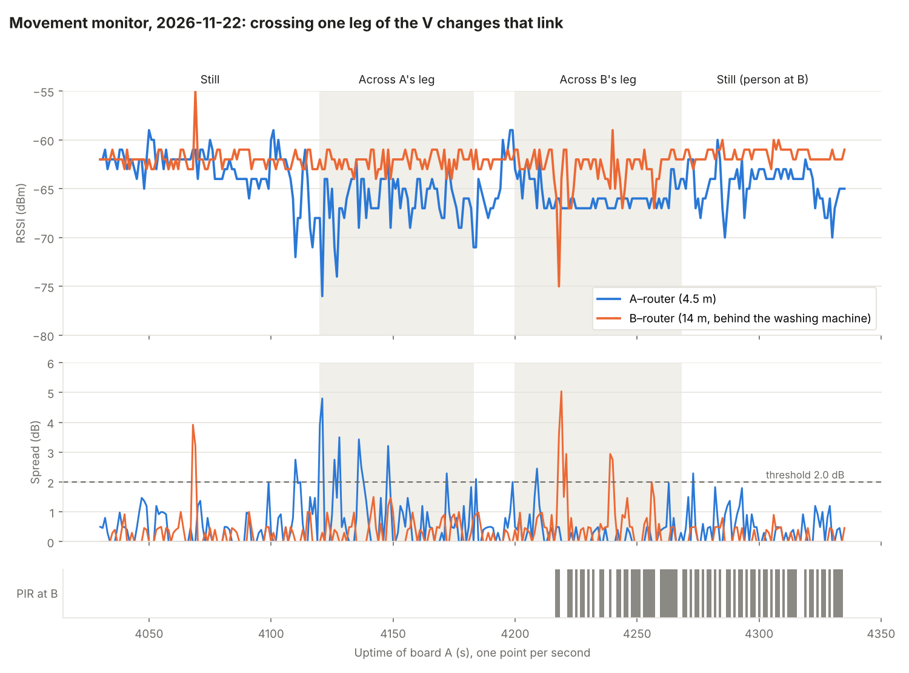

- Crossing A's leg moved only A's link; crossing B's leg moved B's link, and the
  PIR confirms the person was at B.
- A stayed about 4 dB low while the person stood on B's leg, with a flat spread:
  a static obstruction near the point of the V (the router), where the legs meet.
- A level drop of 3–6 dB against the still baseline marks the crossed leg more
  reliably than the 2.0 dB spread threshold, which caught only single seconds.

**Test 3 (B in the kitchen, nearly in line with A).** B was placed in the
kitchen, about 14 m from the router and about 1 m beside the line router–A
(A at 4.5 m). Expected: crossing at 3 m (before A) moves both links, crossing at
9 m (past A) moves only B. During the still periods the author sat at A's desk.

| Uptime (s) | Phase | A–router | B–router |
|---|---|---|---|
| 5074–5095 | at the desk | −58.5 dBm | −65.5 dBm |
| 5095–5150 | crossing at 3 m | −62 dBm (−4 dB), spread up to 4.4 dB | −66 dBm, dips to −70 dBm, spread up to 1.8 dB |
| 5190–5244 | crossing at 9 m | **−67…−69 dBm (−10 dB)**, spread up to 4.8 dB | −66 dBm, spread up to 2.8 dB once |
| 5244–5320 | back at the desk | −56…−58 dBm | −65 dBm |

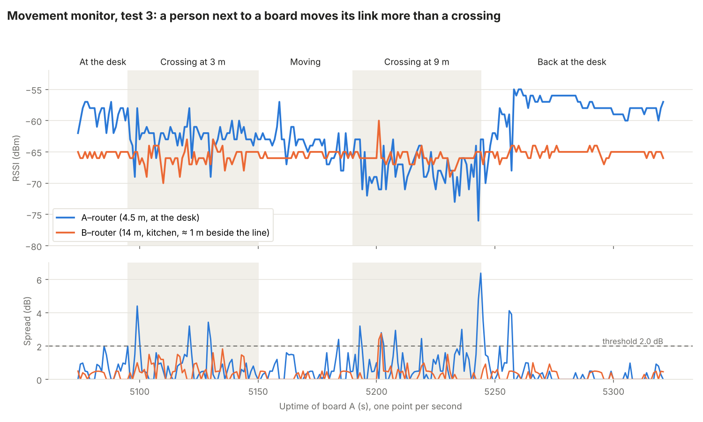

- At 3 m both links reacted, as expected, A more than B.
- At 9 m A dropped about 10 dB and B hardly moved: the opposite of the
  prediction. A's level followed **where the person was**: highest with the
  author next to it at the desk, lowest when he was far away.
- Conclusion: **a person within about 1 m of a board changes that board's RSSI
  more (up to ≈ 10 dB) than a person crossing its path (3–6 dB).** The body
  absorbs and reflects the 2.4 GHz signal right at the antenna and can detune the
  small PCB antenna. It is the same effect as holding a car key to your head to
  reach the car from further away: a body next to an antenna becomes part of it.
- Consequences: place the boards where nobody sits or stands; take the
  empty-room baseline with nobody near any board; a large, lasting change on one
  link can be read as "someone is close to this board".
- Two links about 1 m apart along nearly the same line did not separate
  reliably; the V layout (test 2) did.
- B's PIR was active the whole time in the kitchen (warm surfaces in view), so it
  was no reference in this test.

**Test 4 (calibrated, same kitchen layout as test 3).** New in the firmware:
`k` on A gives 30 s to leave, then records 30 s of the empty room. Per link the
baseline is the median level and the calm spread the largest spread seen; a link
then reports movement when its level is ≥ 3 dB below the baseline or its spread
is above the calm spread + 1 dB. The web page shows baselines and thresholds as
dashed lines. A second person sat still about 3 m from A during calibration and test.

| Uptime (s) | Phase | A–router (baseline −58 dBm) | B–router (baseline −67 dBm) |
|---|---|---|---|
| 1426–1566 | quiet | ≈ 2 dB below baseline, **no alarm** | at baseline, **no alarm** |
| 1566–1596 | walking at 9 m (past A) | drop 4–5 dB, movement in ≈ 4 of 10 s | drop ≤ 2 dB, no alarm |
| 1600–1683 | walking at 3 m (before A), test ends at 1683 | drop 6 dB, movement in ≈ 8 of 10 s | drop 3–4 dB, movement in ≈ 2 of 10 s |

- The calibration works: about 140 s of quiet room gave **no false alarms** on
  either link, with a second person sitting still in the room, and walking was
  detected clearly.
- As in test 3, the in-line layout does not tell 3 m from 9 m: A, in the same
  room, reacts to a person anywhere in the room (reflections), and B's long
  link reacts only weakly. At 3 m both links reacted, as expected.
- The live page on A (`http://lab8-esp32.local/`) after calibration: dashed lines are each link's
  empty-room baseline and movement threshold; grey bands are B's PIR (constantly active next to
  the fridge in the kitchen).

  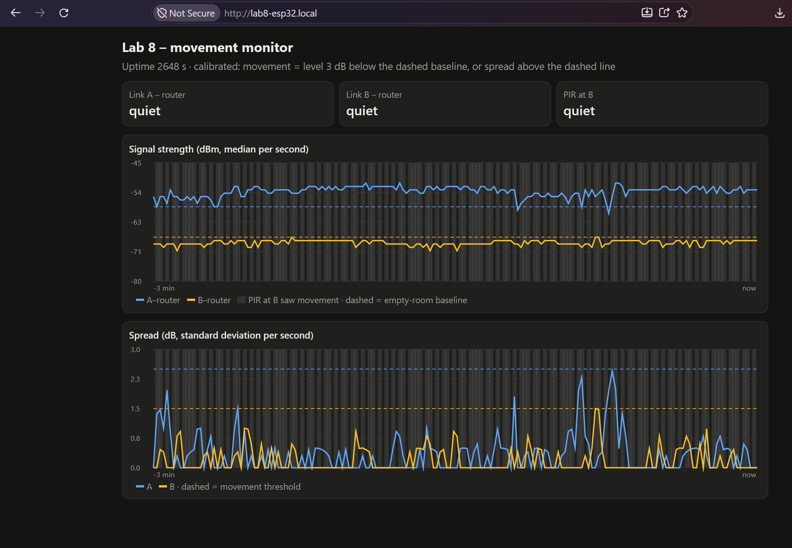

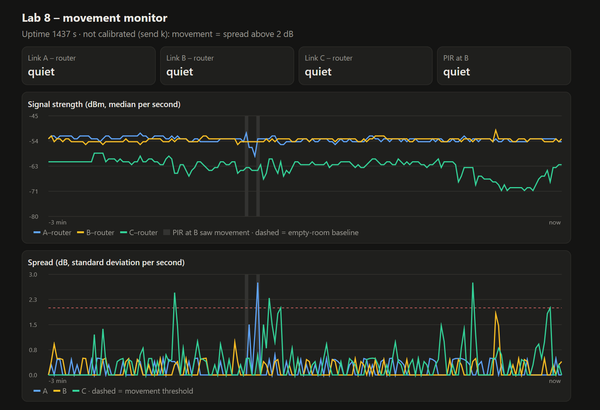
- So the calibrated monitor answers **"is someone moving?"** reliably; **"where?"**
  needs links with separate paths, as in the V layout (test 2).
- B's PIR in the kitchen was active the whole time (warm surfaces), so it was no
  reference here.

- **Wi-Fi leads the PIR on approach (2026-11-24).** Watching the live page, the
  C-link spread (green) rose a second or two *before* the PIR fired: the Wi-Fi path
  reacts to a body crossing the link while the person is still approaching, whereas the
  PIR only triggers once they are inside its cone. So the Wi-Fi radar detects an
  approaching person earlier than the co-located PIR — a point for the KK2 conclusions
  and for future work (a faster "someone is coming" signal than a motion sensor).
- Next step (FR-RADAR-4): repeat the calibrated test in the V layout; add board C as a third link.
- Power during the monitor: B ≈ 0.67–0.77 W (≈ 130–145 mA) on the power bank.

## Board C (`lab8-echo2`)

Board C is the third ESP32-S3 (from the 2-pack with B). It runs the **same
firmware as A and B**, `lab8_bandwidth.cpp`; the role and the host name come
from jumpers read at start-up:

| Board | GPIO 42 to GND | GPIO 41 to GND | Role | Host name | Planned address |
|---|---|---|---|---|---|
| A | – | – | Controller: bandwidth test, movement monitor, web page, LCD | `lab8-esp32` | 192.168.32.50 |
| B | ✓ | – | Echo server, PIR, INA226 | `lab8-echo` | 192.168.32.51 |
| C | ✓ | ✓ | Second echo server | `lab8-echo2` | 192.168.32.52 |

- Without the GPIO 41 jumper, C would call itself `lab8-echo` like B, and the
  router would see two boards with the same name.
- C has no INA226 and no PIR yet: power is reported as 0, and the PIR pin has a
  pull-down, so an unconnected pin reads a steady 0.
- C answers `STATUS?` and `MEAS?` like B. The bandwidth test runs against both
  B and C (3 legs), and the movement monitor now queries both B and C, so the
  web page shows three links (A, B, C).
- Wi-Fi credentials are entered once in C's setup menu and stay in its flash.

**Set-up test (2026-11-24):** with both jumpers C starts as
`ROLE role=echo host=lab8-echo2`, joins the router
(`WIFI_STATUS connected=1 hostname=lab8-echo2 ip=192.168.32.52 rssi=-63 channel=11`)
and reports `ECHO_READY port=5001` (`INA226 ok=0`, as expected without an INA226).
With only the GPIO 41 jumper it started as a controller named `lab8-esp32`:
GPIO 41 is only read when GPIO 42 is grounded.

**Addresses (NFR-NET-1, 2026-11-24):** DHCP reservations (MAC-IP binding) in the
router: A → 192.168.32.50, B → .51, C → .52; all three verified in the router's client list. The router has no
local DNS for its clients (`nslookup lab8-esp32` finds nothing), so the boards are
reached by their mDNS names (`lab8-esp32.local`, `lab8-echo.local`,
`lab8-echo2.local`) or their reserved addresses. A's fallback address for B is now
.51.

**All three boards together (2026-11-24):**

The 3-leg bandwidth (`r`) test completes against both echo servers with no lost
packets. Each echo server also prints the router RSSI it measures. The movement
monitor runs automatically — it starts after the boot series and resumes by itself
after every `r` run, so there is no separate command to turn it on. The only
Serial commands are `r` (run the bandwidth test again) and `k` (empty-room
calibration).

Board A syncs its clock over NTP at start-up (`TIME_SYNC ok=1 time=…`) and prints
the wall-clock date and time at the head of each leg's 7 results
(`BW_SERIES start=1 node=B time=2026-11-24 17:09:44`), so every block of 7 is
self-dated.

**On the web page:** below the two movement charts the page now shows a bandwidth
section with **one small graph per packet size** (7 graphs, 32 B … 1460 B) in a
responsive grid — 5 across on a laptop, 2 across on a phone. Each graph plots that
size's history over the stored runs: **throughput** (solid line, Mbit/s, left
axis) and **median RTT** (dashed line, ms, right axis), for B (amber) and C
(emerald), newest run at the right. The firmware keeps a rotating buffer of the
last **20 runs** (20 × 7 sizes × 2 legs = 280 values; each new run is well under
1 % of the buffer) and serves them at `/api/bw`. It updates every 5 s (bandwidth
only changes when `r` is run).

Running the `r` test pauses the monitor, runs the three legs, then **auto-continues
with the monitor**. The movement charts break the line across that pause (samples
more than 3 s apart are not joined), so the gap where the bandwidth was measured is
visible on the time axis.

**For the report:** the same `BW_RESULT` lines are also kept in a host-side log,
`lab8_bandwidth_log.csv` (date, time, run, node, size, kbps, rtt_med_us, lost), and
`make_bw_chart.py` re-renders the static two-panel graph below (throughput and
median RTT) with each `r` run stacked as a dated line. (Run 1 was captured before
the NTP change, so its time shows as `time-unknown`.)

### Why the 3 Mbit/s is not the Wi-Fi limit (8.7 performance test)

The `r` test's ~3 Mbit/s looks low for Wi-Fi, but it is a **method artefact**: it is
stop-and-wait (one packet in flight), so it measures `2 × size / RTT`, not the channel.
A follow-up performance investigation (firmware **v8.7.0**, Serial command `w`) added a
windowed one-way UDP burst that measures the ESP's real throughput, loss and jitter, with
a PC-side helper (`udp_perf.py`) and an iperf3 PC↔PC reference. Measured 2026-11-26:

| Measurement | What limits it | Result |
|---|---|---|
| `r` echo test (stop-and-wait) | RTT (one packet in flight) | ~3 Mbit/s |
| `w` test (ESP, windowed burst) | ESP TX (single stream + CPU) | **~11 Mbit/s**, 2.3 % loss, jitter <2 ms |
| iperf3 PC↔PC, 2.4 GHz (two hops) | Wi-Fi link only | ~40 Mbit/s (TCP), ~48 Mbit/s (UDP ceiling) |

So the story is **3 → 11 → 48 Mbit/s** (method → ESP → link): windowing roughly triples the
ESP number, but the ESP itself tops out near ~11 Mbit/s — about ¼ of the link — so the
**node, not the Wi-Fi, is the bottleneck.** Full detail, protocol and sweeps:
[lab8_wifi_performance.md](lab8_wifi_performance.md).

## Photos

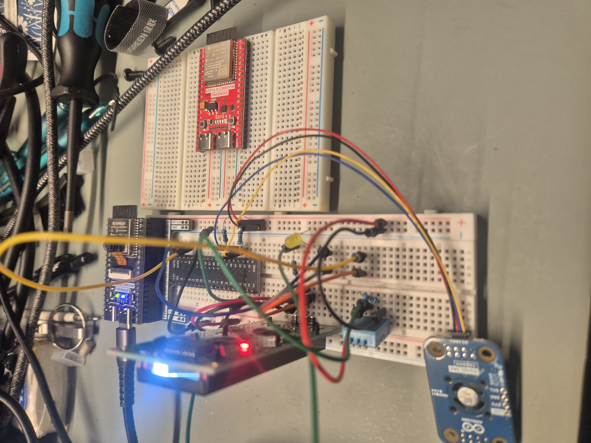

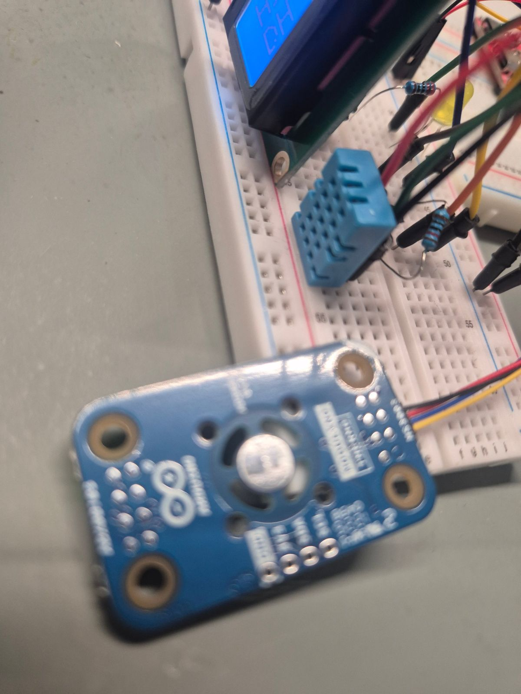

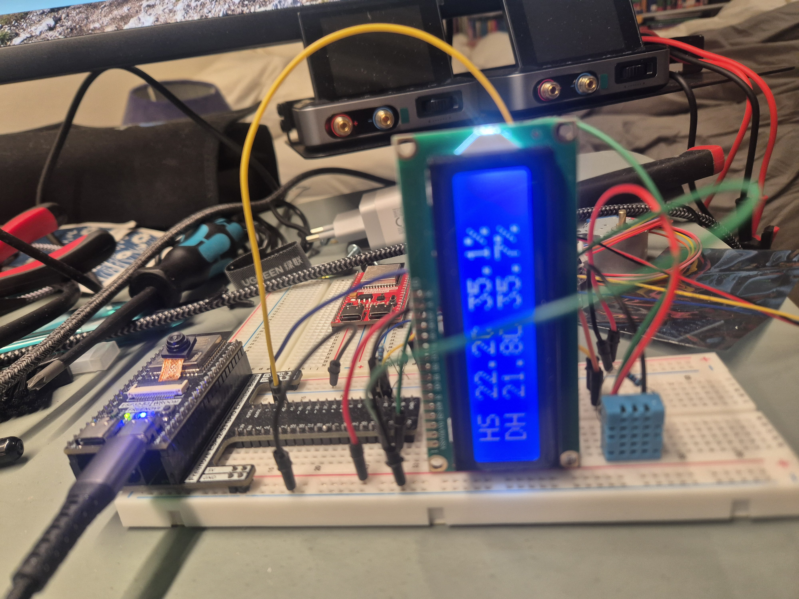

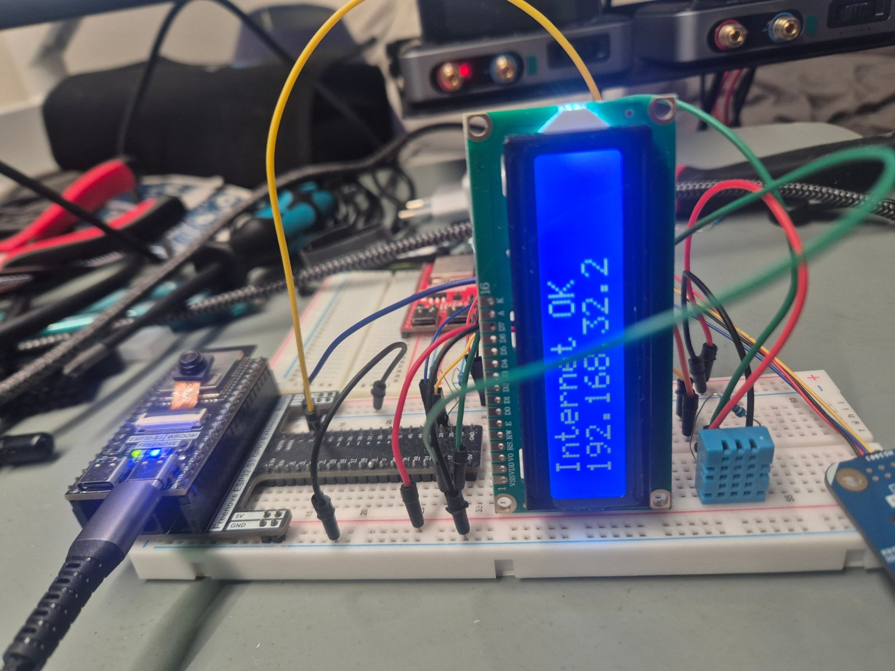

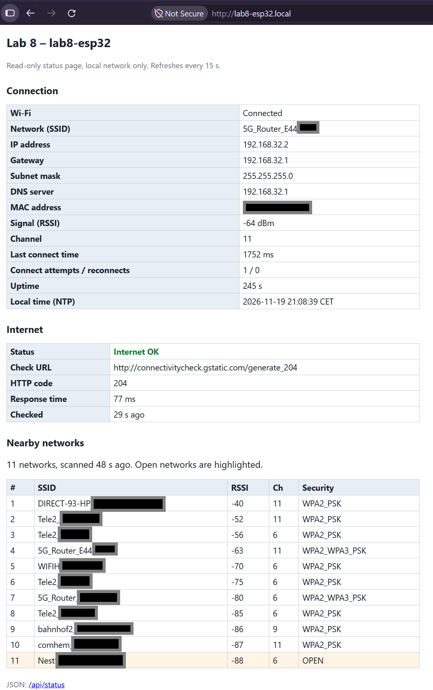

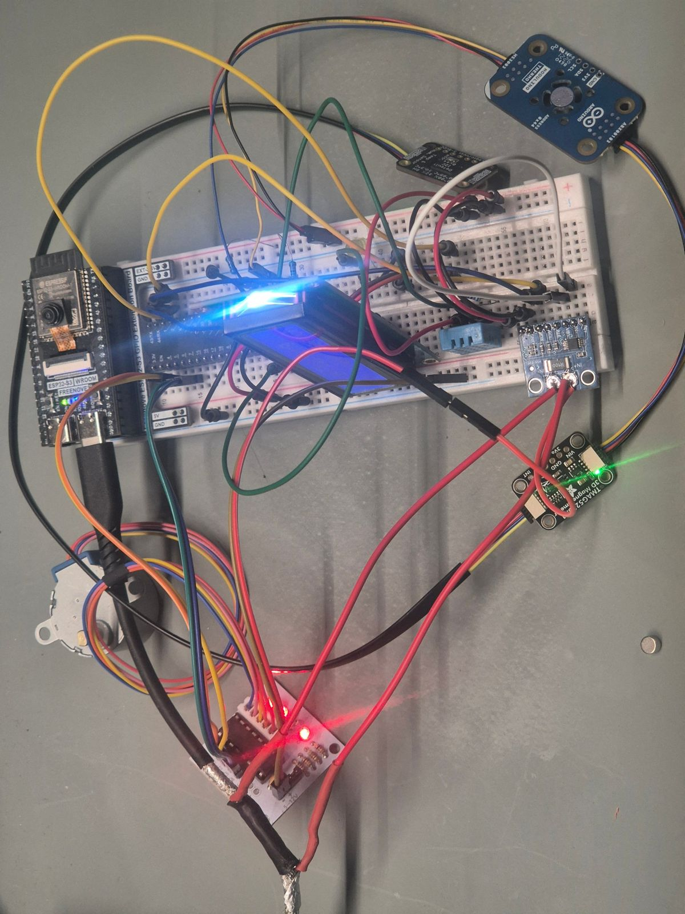

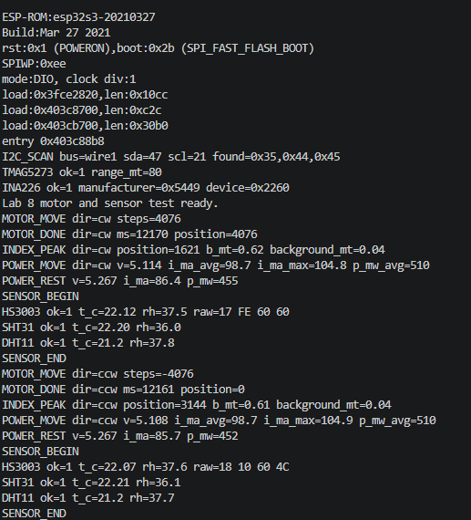

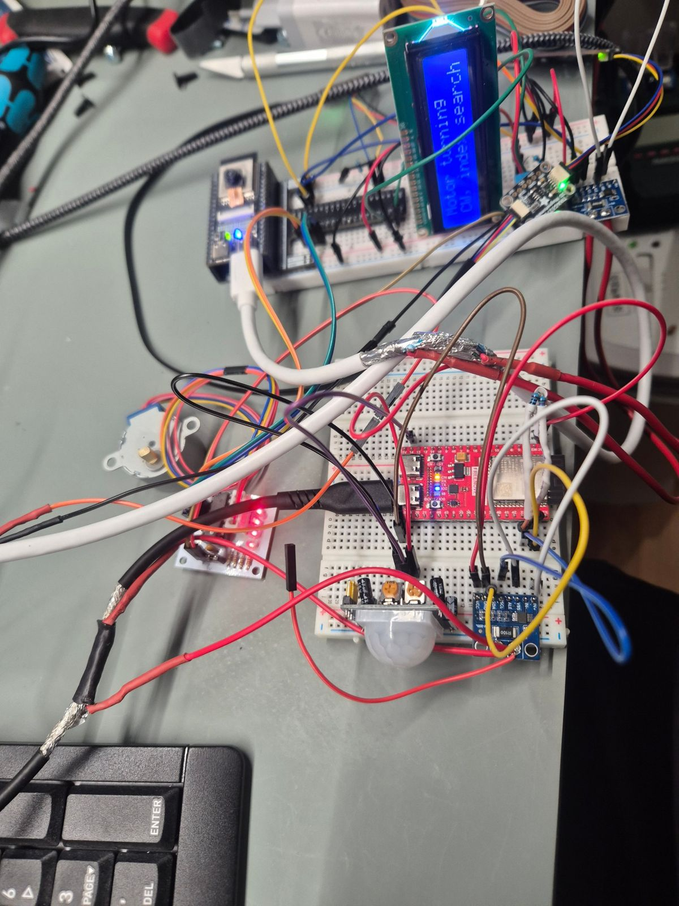

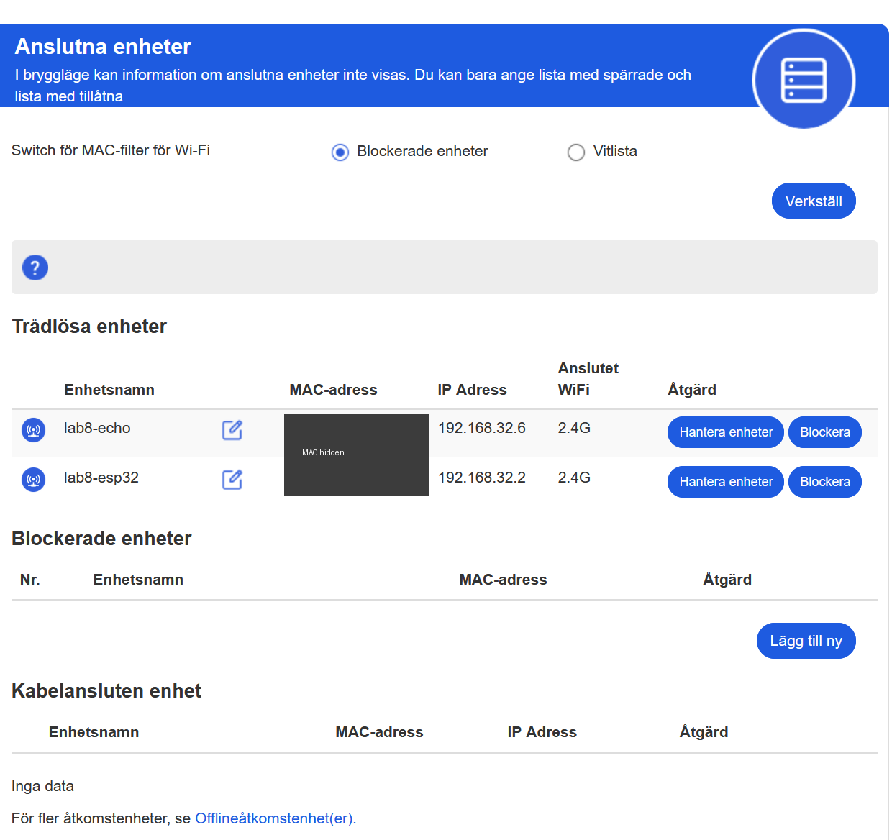

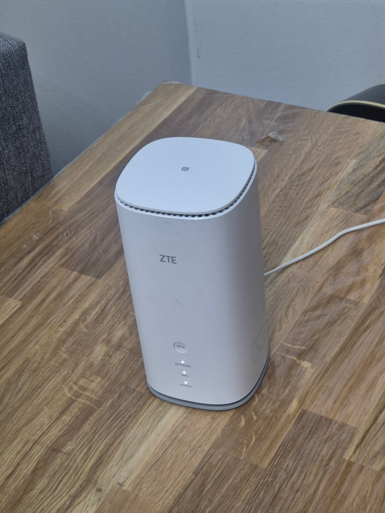

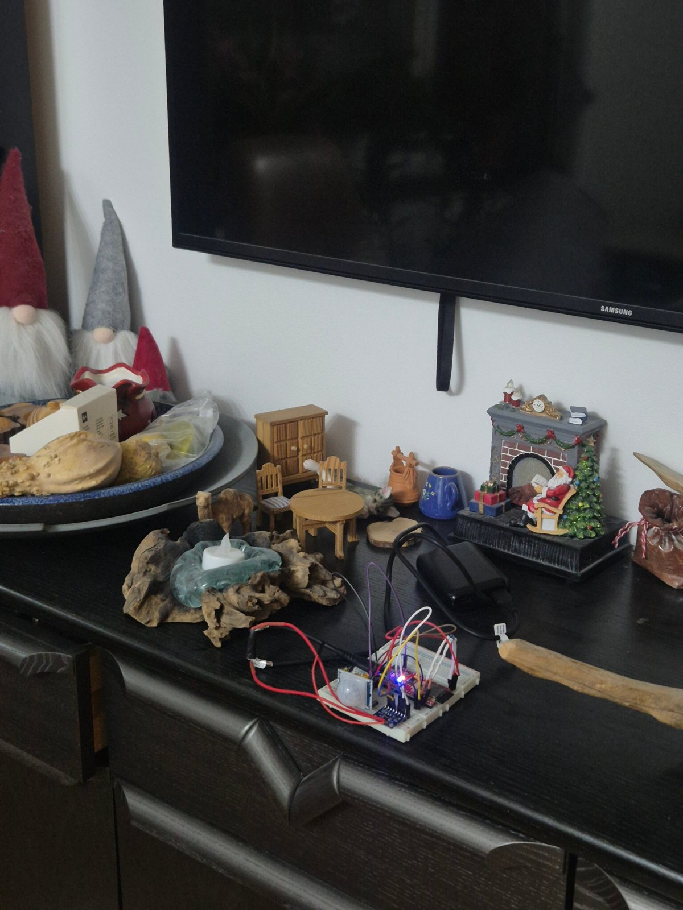

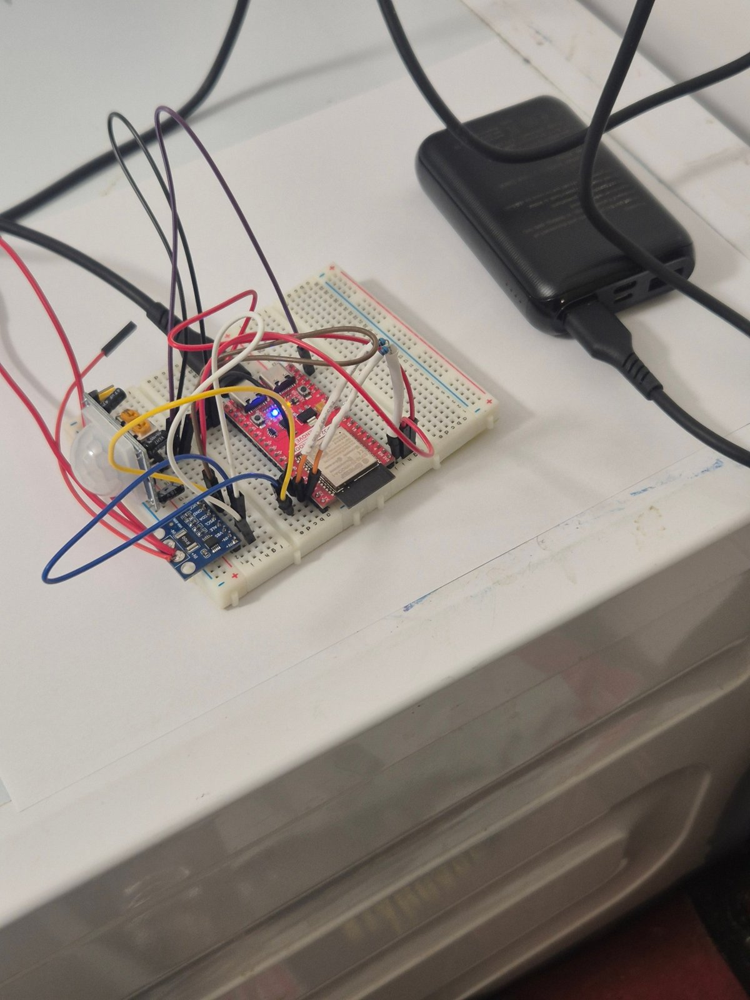

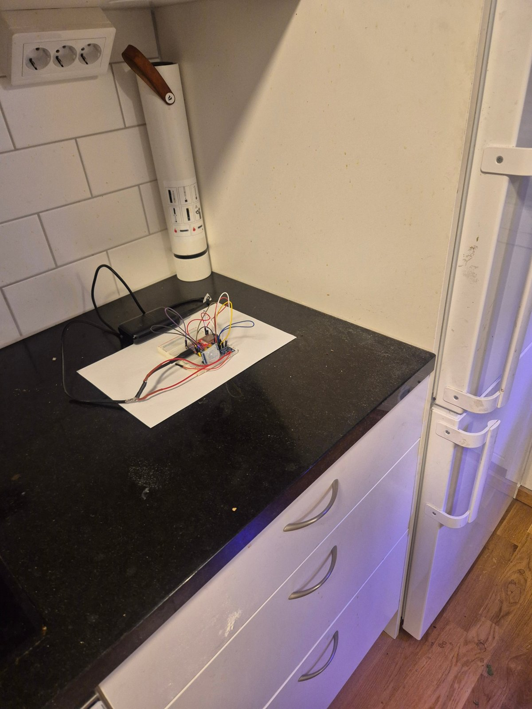

## Security

The full analysis (assets, threat actors, risk register, open issues) is in
[`lab8_wifi_security_analysis.md`](lab8_wifi_security_analysis.md)
([PDF](lab8_wifi_security_analysis.pdf)). Summary:

### Evolution of credential protection

| Level | Where the password is | Protects against | Status |
|---|---|---|---|
| 0 | Plain text in the source code | Nothing | Avoided from the start |
| 1 | Plain text in `include/wifi_credentials.h`, ignored by git | Leaks via GitHub | 8.1 |
| 2 | XOR-obfuscated in ESP32 flash (NVS), typed in over Serial | + passwords in source/firmware, readable flash dumps, copying to another board | **8.4b (current)** |
| 3 | AES-GCM in flash, key hidden in a read-protected eFuse | + decoding with source code and MAC | Documented, not implemented |
| 4 | Flash encryption + NVS encryption + Secure Boot | + attacker's own firmware on the board | Documented, not implemented |

### Credentials on the board (implemented, 8.4b)

Wi-Fi SSIDs and passwords are no longer compiled into the firmware. They are
typed in once over Serial (press `c` within 3 s after reset) and stored in the
ESP32's NVS memory by `include/lab8_credentials.h`.

Storage is **XOR-obfuscated**: each value is XORed with a keystream
(xorshift32) seeded from a hash of a salt, the chip's unique eFuse MAC address
and the NVS key name.

| Protects against | Does not protect against |
|---|---|
| Passwords in git, in the source or in the `.bin` file | Someone with the board, this source code and the chip's MAC (readable with esptool) |
| Readable SSIDs/passwords in a flash dump (`strings`) | An attacker who flashes own firmware that calls `loadCredentials()` |
| A flash copy working on another ESP32 | |

This is obfuscation, not encryption: the key is derived from information that
is not secret.

### Why MAC-XOR must never be used for transmission

`data XOR mac` sent over Wi-Fi is not protected: the MAC is sent in clear in
every Wi-Fi frame, so a listener has both the ciphertext and the key
(`sent XOR mac = data`). The key is also short (6 bytes, repeated) and never
changes, so equal messages give equal output. Data in transit needs TLS.

### Next level: AES with a hidden eFuse key (not implemented)

1. Once: burn a random 256-bit key into an eFuse key block with `espefuse.py`,
   purpose `HMAC_UP`, read-protected. Neither software nor esptool can read it.
2. Firmware: the ESP32-S3 HMAC peripheral derives an AES-256 key from the
   hidden key; credentials are stored in NVS with **AES-GCM** (encrypted and
   tamper-checked, new random nonce per write).
3. Result: a flash dump is useless even with the source code.

Not used here because the eFuse change is permanent and uses one of six key
blocks. Remaining risk: firmware flashed by an attacker can still ask the HMAC
peripheral to decrypt; stopping that needs **Secure Boot**. The full official
route is **flash encryption + NVS encryption**, which burns more eFuses, fits
poorly with PlatformIO's Arduino setup and can brick the board if done wrong.

### Risks and decisions

| Risk | Measure | Decision |
|---|---|---|
| Passwords leaked via GitHub | Credentials not in source; `.gitignore` covers `include/wifi_credentials*.h` | Fixed |
| Passwords shown on Serial/LCD/web page | Never printed; typed passwords echo `*` | Fixed |
| Passwords read from a stolen board | XOR obfuscation; unattended boards (friggebod) on a separate guest/IoT network | Reduced; AES/eFuse documented as next level |
| Internet check readable in transit | HTTPS with certificate verification (`WiFiClientSecure`, not `setInsecure()`) | Planned |
| DNS lookups, server name, IP/MAC, timing visible | Cannot be hidden in normal networking | Accepted: reveals only which server is contacted |
| ESP32 web page (8.5) over plain HTTP | Read-only, shows no secrets; smoke-test asserts no password in output | Accepted on own WPA2 network |
| Print job (8.7) unencrypted on port 9100 | Purpose is a readable paper copy, so encrypting the path protects nothing; content is broadcast SSIDs; only printer + ESP32 on the WPA2 Wi-Fi Direct network; report never contains credentials | Accepted |
| Malicious SSID (e.g. containing `<script>`) shown on the web page | Every SSID HTML/JSON-escaped; no JavaScript; CSP blocks scripts; smoke-test checks for `<script>` | Fixed |
| NTP time can be spoofed on the network (NTP is unauthenticated) | Only affects displayed time and log timestamps; matters for HTTPS certificate dates later (I-1) | Accepted |

Wi-Fi itself is protected by WPA2/WPA3 on the radio link; TLS protects
connections to the internet; neither protects data stored on the board.

## AI Assistance

This project was developed with assistance from Claude (Anthropic), which
supported coding, documentation and diagram creation.
The ideas, concepts, analysis and design decisions are the author's own. The
author has reviewed and tested the code, made selected modifications and
refinements, and clarified comments where appropriate.
Git and GitHub repositories, including version control and project
management, have been managed and controlled by the author.

## Intellectual Property Rights

All intellectual property rights (IPR) in the project, including its concepts,
design, architecture, source code, documentation and associated materials,
are owned by the author. The use of AI assistance does not transfer ownership
of these rights to Anthropic or any other third party.
