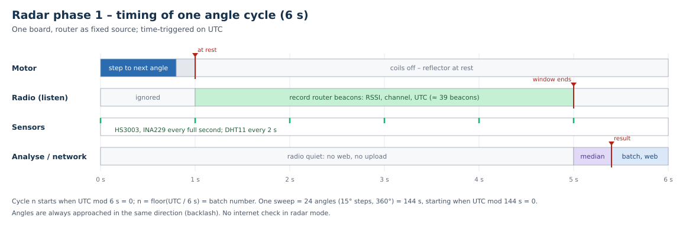
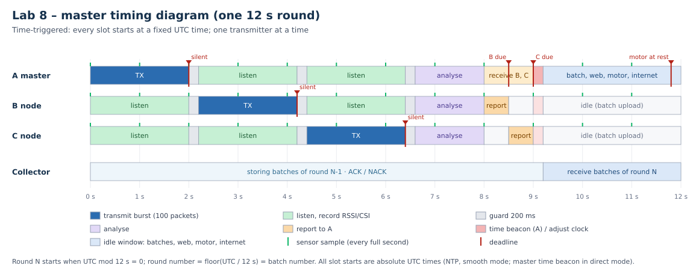

# 1. Purpose and phases

This document describes how timing is handled in the planned measurement
system: graphs and history (8.5b), the bandwidth test (8.6), the experiments
(8.6b, 8.6c) and the Wi-Fi radar. The radar is built in phases, and each phase
adds to the timing of the previous one:

| Phase | Boards | Signal source | What it gives |
|---|---|---|---|
| **1** | A (controller) with a rotating reflector | The router, fixed, ≈ 3 m away in another room | Direction to the router; movement in the radio path |
| **2a** | A + slaves B and C, listening only | The router | Movement per link (A–router, B–router, C–router): a coarse position |
| **2b** | A + slaves B and C, transmitting in turns | The boards themselves | Three extra links (A–B, A–C, B–C); A's reflector homes in on the direction |

The design is **time-triggered**: every activity starts at a fixed time on a
shared clock. Nothing is driven by free-running loops of the type "every 30 s
since last time" (`millis() - last >= interval`).

The requirements are in `lab8_wifi_requirements.md` (NFR-RT, FR-DATA,
FR-RADAR); the reflector and mechanics are in `lab8_radar_reflector.md`.

# 2. Principles

| # | Principle | Why |
|---|---|---|
| P1 | One global time base: UTC from NTP | All boards agree on *when* things happen |
| P2 | All activities start at absolute times computed from UTC | No drift between boards; no accumulated loop error |
| P3 | Cycles are aligned to UTC (a cycle starts when `UTC mod T = 0`) | Every board computes the current cycle on its own, with no message |
| P4 | While a board measures, it does not transmit; in phase 2b only one board transmits at a time | Clean measurements; no collisions |
| P5 | Event-driven work (web requests, uploads, motor steps) only in its window | Measurements are never disturbed by unplanned activity |
| P6 | Every expected message has a known deadline | A missing message is detected *at its deadline*, not by waiting |
| P7 | A board that has lost time synchronization stops transmitting (fail-silent) | An unsynchronized board must never disturb another's slot |

# 3. Time base

| Mode | Time source |
|---|---|
| Router mode (phases 1, 2a, and 2b via the router) | All boards use NTP (`se.pool.ntp.org`, `pool.ntp.org`) in **smooth** mode (`SNTP_SYNC_MODE_SMOOTH`): the clock is slewed gradually, never stepped, so a window never jumps. |
| Direct mode (no internet) | The master (A) is the time source; its UTC time is sent in every round's time-beacon slot, and the slaves adjust towards it. A was set by NTP before leaving the router network. |

Two errors decide how far apart the clocks can be: the **synchronization
error** after a sync (NTP over Wi-Fi: typically tens of milliseconds) and the
**drift** between syncs:

$$\Delta t_{drift} = \text{tolerance (ppm)} \times 10^{-6} \times t_{since\ sync}$$

Guard times (phase 2b) must be larger than the sum. Each slave measures its
offset to the master every round, so the actual value is known.

| Condition | Action |
|---|---|
| Offset larger than half the guard time | The slave stops transmitting, reports `SYNC_LOST`, keeps listening |
| Offset within limit for 2 rounds | The slave resumes and reports `SYNC_OK` |
| No valid time at all | No cycles start; the board waits |

# 4. Phase 1: one board, rotating reflector

## 4.1 Angle cycle

One angle cycle lasts **6 s** and starts when `UTC mod 6 s = 0`. The cycle
number `n = floor(UTC / 6 s)` is also the batch number.



| Time in cycle | Motor | Radio | Analyse / network | Deadline |
|---|---|---|---|---|
| 0.0–0.8 s | Step to the next angle (coils on) | Beacons ignored | Quiet | – |
| 0.8–1.0 s | Settle, then **coils off** | Ignored | Quiet | **Hard: at rest at 1.0 s** |
| 1.0–5.0 s | At rest | **Record router beacons**: RSSI, channel, UTC (≈ 39 beacons at the router's ≈ 102 ms interval) | Quiet: no web, no upload | Window ends at 5.0 s |
| 5.0–5.4 s | At rest | – | Median per angle, channel check | Soft: result at 5.4 s |
| 5.4–6.0 s | At rest | – | Batch to the collector, web requests | Before the next cycle |

## 4.2 Sweep

One sweep is **24 angles** (15° steps over 360°) = **144 s**, starting when
`UTC mod 144 s = 0`. Every angle is approached in the **same direction**
(backlash). After a sweep, the curve fit (direction θ₀, beam width σ, leakage
C) is calculated in the network window of the last cycle and shown on the LCD
and the web page.

## 4.3 Beacon capture

- Beacons are captured with the ESP32's promiscuous receive callback, filtered
  on the router's MAC address (BSSID); `WiFi.RSSI()` is too slow (an average).
- Each beacon is stored with RSSI, channel and UTC time; only beacons inside
  the window 1.0–5.0 s count.
- **No locked channel:** a channel change is logged as an event; values within
  a few seconds of it are flagged; the baseline is calculated per channel.
- No internet check runs in radar mode; the board only needs the router
  network for NTP and the collector.

# 5. Phase 2: slaves help pinpoint the direction

## 5.1 Phase 2a: passive slaves

B and C are placed at fixed points around the area, each listening to the
**same router beacons** as A, in the **same windows** (1.0–5.0 s of each
cycle, aligned on UTC). No board transmits during the window.

- Each board measures the variation on **its own link to the router**.
- Movement disturbs the links it crosses; which links are disturbed gives a
  **coarse position** (a sector).
- A's reflector is then stepped **only within that sector** instead of a full
  sweep, which homes in on the direction several times faster.
- B and C report their results as batches in the network window (5.4–6.0 s);
  A combines them.

This needs no new timing beyond phase 1: the same cycle, three listeners.

## 5.2 Phase 2b: active slaves

The boards also transmit to each other, adding three links (A–B, A–C, B–C)
that do not depend on the router. They take turns in a **12 s round**,
starting when `UTC mod 12 s = 0`:



| Time in round | A (master, reflector) | B (slave) | C (slave) | Deadline |
|---|---|---|---|---|
| 0.000–2.000 s | **Transmit** burst | Listen, record | Listen, record | Hard: A silent at 2.000 |
| 2.000–2.200 s | Guard | Guard | Guard | – |
| 2.200–4.200 s | Listen, record | **Transmit** burst | Listen, record | Hard: B silent at 4.200 |
| 4.200–4.400 s | Guard | Guard | Guard | – |
| 4.400–6.400 s | Listen, record | Listen, record | **Transmit** burst | Hard: C silent at 6.400 |
| 6.400–6.600 s | Guard | Guard | Guard | – |
| 6.600–8.000 s | Analyse | Analyse | Analyse | Soft: result at 8.000 |
| 8.000–8.500 s | Receive B's report | **Send report** | – | B's report due at 8.500 |
| 8.500–9.000 s | Receive C's report | – | **Send report** | C's report due at 9.000 |
| 9.000–9.200 s | **Send time beacon** (direct mode) | Adjust clock | Adjust clock | – |
| 9.200–12.000 s | Idle window: reflector step, batch, web | Idle | Idle | Reflector at rest by 11.800 |

A burst is 100 packets, one every 20 ms. Movement shows as increased variation
on the links it crosses; both directions of a link are measured, so a
disturbance seen in both is reliable. A's reflector moves one step per round
within the sector the links point at.

# 6. Sensor sampling

All boards sample at fixed instants, so values from different boards share
time stamps:

| Sensor | Board | Instant |
|---|---|---|
| INA226 current, voltage, power | A (radar); A and B (8.6) | Every full second |
| HS3003 temperature, humidity | A | Every full second |
| DHT11 temperature, humidity (reference) | A | Every even second (sensor limit 2 s) |
| Router beacon RSSI | Listener | Every captured beacon in the window |
| Burst packet RSSI (phase 2b) | Listener | Every received burst packet |

# 7. Data flow and deadlines

## 7.1 Batches

Each board sends one batch per cycle (phase 1, 2a) or round (phase 2b):

```
DATA node=B boot=17 batch=<cycle number> part=1/1 crc=8F3A21C4
<seq> t=<UTC ms> kind=<kind> ... value=<value>
```

- **The batch number is the cycle or round number.** The collector computes
  from its own clock which batch each board should have sent, so it knows what
  is missing at the deadline.
- `crc` is CRC-32 over the value lines (HMAC-SHA256 as the next level).
- `boot` is a counter in NVS, incremented at every start.

## 7.2 Receipts

| Message | Meaning |
|---|---|
| `ACK node=B boot=17 batch=N` | Batch N received, CRC correct, flushed to disk |
| `NACK node=B boot=17 batch=N reason=crc` | Batch N damaged; send it again |
| `NACK node=B boot=17 batch=N reason=missing` | Batch N was due but has not arrived; send it again |

## 7.3 Deadlines

| Expected | Due by | If missing |
|---|---|---|
| Batch N at the collector (phase 1, 2a) | End of cycle N + 1 | `NACK reason=missing` |
| Batch N at the collector (phase 2b) | Round N + 1, 11.000 s | `NACK reason=missing` |
| Report B / C → A (phase 2b) | 8.500 / 9.000 s | A marks the round incomplete for that slave |
| ACK/NACK at the sender | 2 s after sending | Resend in the next network window |
| Time beacon at B/C (direct mode) | 9.200 s | Own clock; after 3 misses, check the offset limit |

Resends only happen in a network or idle window, never while measuring.

# 8. Implementation on the ESP32-S3

| Topic | Design |
|---|---|
| Scheduling | Each window start is computed as an absolute UTC time from `gettimeofday()`; a one-shot `esp_timer` fires at that instant. The next timer is computed from the clock again, never from the previous timer. |
| Cores | Wi-Fi on core 0 (default). Window handlers as a high-priority task on core 1; web server and uploads as low-priority work, only in their windows. |
| Blocking | Window handlers never block; network calls have timeouts shorter than the remaining window. |
| Wi-Fi power saving | Off (`WiFi.setSleep(false)`) on all boards. |
| Time stamps | Microseconds from `esp_timer_get_time()` for intervals; UTC milliseconds for the data. |
| Web server | Requests during a measuring window are answered in the next network window (TCP holds the connection). |
| Motor | Steps only in its window; coils off before the measuring window. |

**Limitation:** Wi-Fi access to the air is not deterministic (the radio waits
for a free channel and retransmits on errors). The design guarantees when the
application starts an activity; windows and guard times absorb the variation.

## 8.1 Implementation status (firmware v8.6.x)

The built firmware realises the time base and sampling cadence of this design, with
two deviations worth recording:

- **The bandwidth (`r`) test is blocking, by design for that tool.** It runs the three
  legs as a single ~5–7 s sequence rather than in non-blocking windows, so the 1 s
  movement sampling and the web server both pause while it runs. The movement monitor
  resumes automatically afterwards, and the pause is shown on the live charts as a
  shaded "r" band whose width is the measured run duration. This is acceptable because
  the bandwidth test is a manual, on-demand measurement, not part of the continuous
  monitor.
- **Bandwidth runs are NTP-timestamped.** Each run is tagged with the wall-clock time
  from the shared NTP base (P1), so runs are self-dated on the terminal and on the web
  page — a direct use of the one-global-time-base principle.

## 8.2 Could the web server run off-core so it never halts?

The blocking `r` test freezes the monitor and the web page for ~5–7 s. The obvious fix
is to move the web server (and the 1 s sampler) to its own FreeRTOS task, pinned to the
other core, so the page keeps updating — "every second is a second shown."

**Benefits:** the monitor never pauses, the page stays responsive, and the pattern
generalises to any future long operation. Energy cost is ~nil — both cores are already
powered in the always-on design.

**Cost 1 — shared data (routine).** Two tasks would read and write the same history and
bandwidth ring buffers. This is the normal case and is handled the normal way: a
**mutex / binary semaphore** (or a short `portMUX` critical section) around each buffer,
with the writer holding it only while it swaps in a finished sample. Low risk, well
understood; it is not the reason to avoid the split.

**Cost 2 — sampling disturbance, and it is manageable.** The monitor and the bandwidth
test are packets over the **same router link**. The monitor reads the RSSI of frames
*from the router* (beacons, and data the router relays); the test's UDP packets travel
A→router→B, so a receiving node actually sees **more** router-link RSSI samples during a
test — the same signal a moving person disturbs, not a foreign one. What the test changes
is the **sampling pattern**, in two ways:

1. the node is briefly **deaf while its own radio transmits**, so a few samples are
   missed, and
2. the sample rate jumps from ~one-per-beacon (≈10/s) to one-per-packet (hundreds/s),
   which a naïve standard deviation would misread as extra spread.

Both are measurement-design problems, solved in software: timestamp each RSSI sample,
compute spread only over comparable samples (or over the quiet gaps between packet-size
bursts), and flag windows with too few genuine beacon samples. The radio contention is
real but it changes *when* and *how often* we sample, not the underlying signal.

**Turned around, this is an improvement.** A beacon arrives only ~10 times a second; a
packet flood gives hundreds of router-link RSSI samples a second. Handled with
rate-aware statistics, the test window is the **densest, highest-resolution** sensing
window we have, not the worst. Deliberately injecting traffic to sample the channel more
often is precisely the idea behind active Wi-Fi sensing (CSI-based systems do this on
purpose). The `r` test could therefore double as a short, high-rate movement probe — a
natural line for KK3/future work.

**Conclusion.** The off-core web task is a sound, cheap improvement for responsiveness,
the data-sharing is a solved problem (semaphores), and — contrary to a first reading — the
bandwidth test need **not** corrupt the monitor, because both ride the same router link
and the disturbance is only in the sampling pattern. So the halt is a **simplification of
the current single-threaded design, not a necessity.** Keeping the shaded band would then
be a choice for clarity (marking a window sampled differently), not a requirement.

# 9. Monitoring

Logged per cycle or round, sent in the batches and shown as graphs:

| Kind | Meaning | Limit |
|---|---|---|
| `window_jitter_us` | Actual window start minus planned start | < 1 ms |
| `clock_offset_us` | Slave clock minus master clock (phase 2) | < half the guard time |
| `beacons_rx` | Router beacons captured per window | ≈ 39 |
| `burst_rx` | Burst packets received of 100 (phase 2b) | 100 when undisturbed |
| `channel` | Router channel | Change flagged |
| `deadline_miss` | Missed deadline and by how much | 0 |
| `sync_state` | OK / LOST | OK |

# 10. Verification

| Test | Method | Pass |
|---|---|---|
| Window jitter | Log `window_jitter_us` for 1 hour | 99 % below 1 ms |
| Motor at rest | Log motor state at each window start | Always at rest at 1.0 s |
| Beacons per window | Log `beacons_rx` for one sweep | Close to 39 per angle |
| Clock offset (phase 2) | Log `clock_offset_us` for 1 hour | Always below guard / 2 |
| Fail-silent (phase 2b) | Stop time beacons, force a large offset | Slave stops transmitting, recovers |
| Lost and damaged batches | Python collector drops or damages 20 % of messages | Every batch exactly once, no damaged data |
| Missing batch by deadline | Switch a board off for one cycle | `NACK reason=missing` at the deadline |
